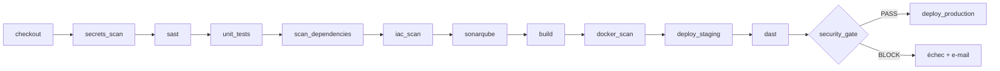

# facturation-api — pipeline CI/CD DevSecOps « shift-left »

Pipeline Jenkins qui intègre **secrets, SAST, SCA, scan d'image, DAST, IaC et SBOM**, avec des
**quality gates** qui bloquent automatiquement toute vulnérabilité critique avant la production.
Le projet est démontré sur deux versions de la même API : le code vulnérable d'origine est bloqué,
le code corrigé passe et se déploie.

*A Jenkins DevSecOps pipeline (secrets, SAST, SCA, container, DAST, IaC, SBOM) with policy-as-code
quality gates, a traced exemption process and security trend history. Demonstrated on a deliberately
vulnerable API (blocked) and its fixed version (deployed). Documentation in French.*

## Résultats mesurés

| | Code vulnérable (`vulnerable`) | Code corrigé (`main`) |
|---|---|---|
| Secrets (Gitleaks) | 4 bloquants | 0 (4 dérogations tracées) |
| SAST (Semgrep + Bandit) | 5 bloquants | 0 |
| Dépendances (Trivy) | 14 bloquants | 0 |
| Image Docker (Trivy) | 114 bloquants | 0 |
| DAST (OWASP ZAP) | 1 High : *Remote OS Command Injection* | 0 |
| SonarQube | note de sécurité E, gate ERROR | note A, gate OK, couverture 98 % |
| **Production** | **bloquée** | **déployée** (non-root, lecture seule) |

## Pipeline



## Démarrage

Prérequis : Docker Desktop (8 Go de RAM alloués), Git, PowerShell.

```powershell
powershell -ExecutionPolicy Bypass -File infra\bootstrap.ps1
```

| Service | URL |
|---------|-----|
| Jenkins | http://localhost:8080 |
| SonarQube | http://localhost:9000 |
| Mailpit (notifications) | http://localhost:8025 |
| API en production | http://localhost:8081/docs |

Les identifiants sont générés aléatoirement et stockés dans `infra\.env`, qui est exclu de Git.

Poste développeur :

```powershell
pip install pre-commit ; pre-commit install          # hooks Gitleaks + Bandit
powershell -File scripts\scan-local.ps1               # mêmes contrôles que la CI, avant push
```

## Documentation

- [Rapport de projet](docs/RAPPORT.md) : analyse as-is / to-be, choix des outils, seuils, résultats
- [Project report (English)](docs/REPORT_EN.md)
- [Captures d'écran](docs/captures/)
- [Procédure de dérogation](docs/PROCEDURE_DEROGATION.md)
- [Préparation à l'oral](docs/PREPARATION_ORAL.md)
- [Politique de quality gates](security/policy.yml) · [Registre des dérogations](security/exemptions.yml)

> ⚠️ La branche `vulnerable` contient **volontairement** des failles et de faux identifiants
> (déjà invalides) pour la démonstration. Ne pas la déployer hors du laboratoire.
