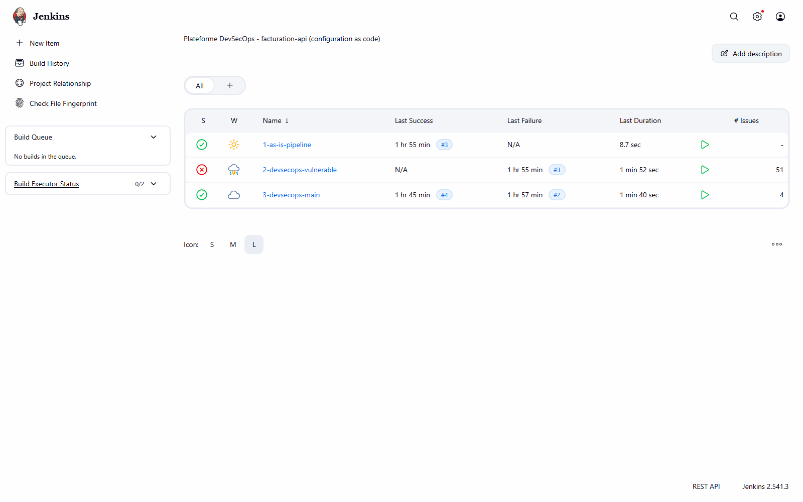
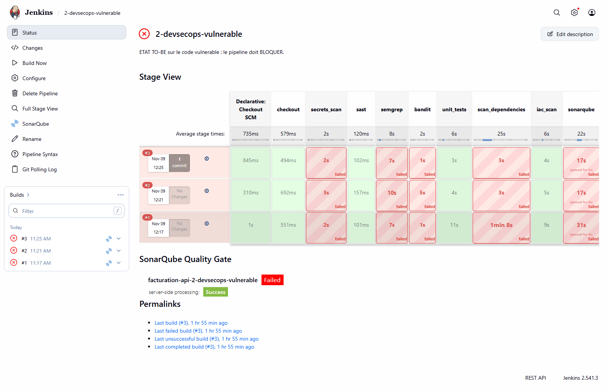
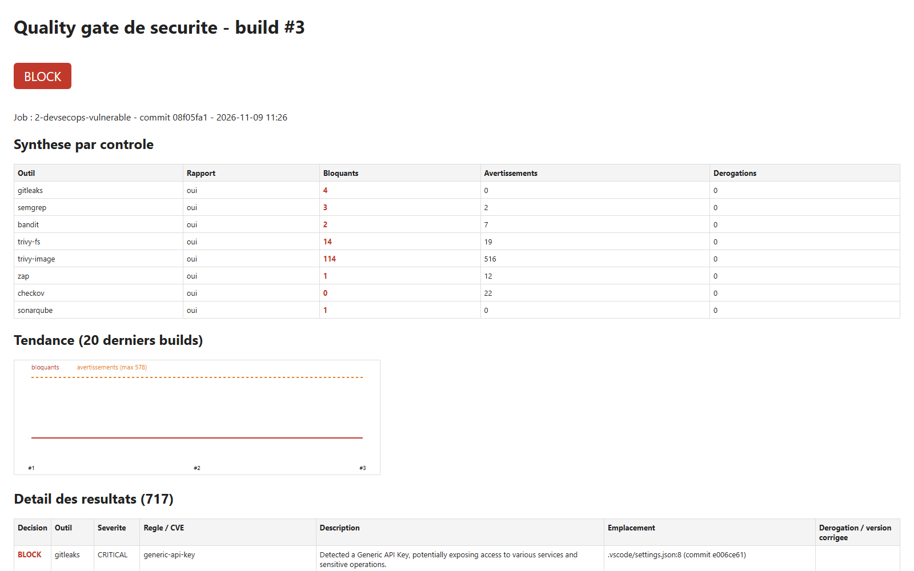
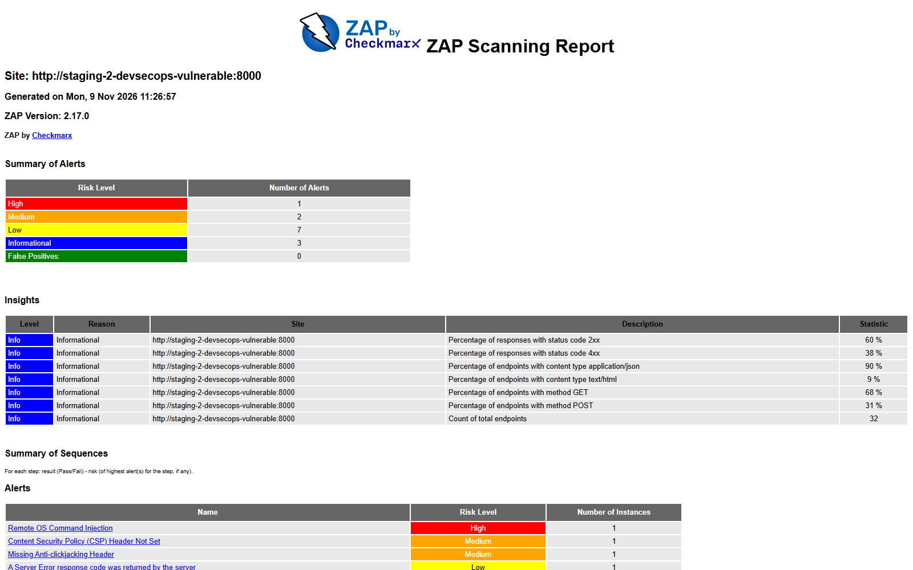
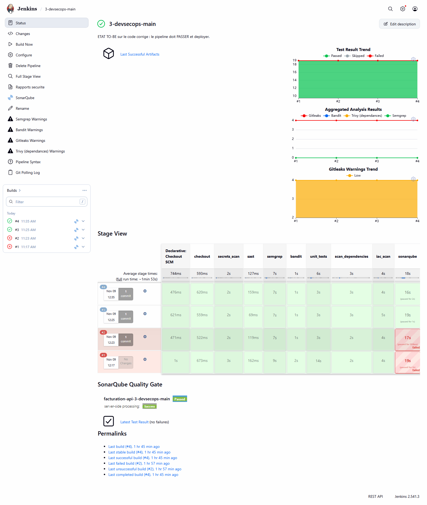
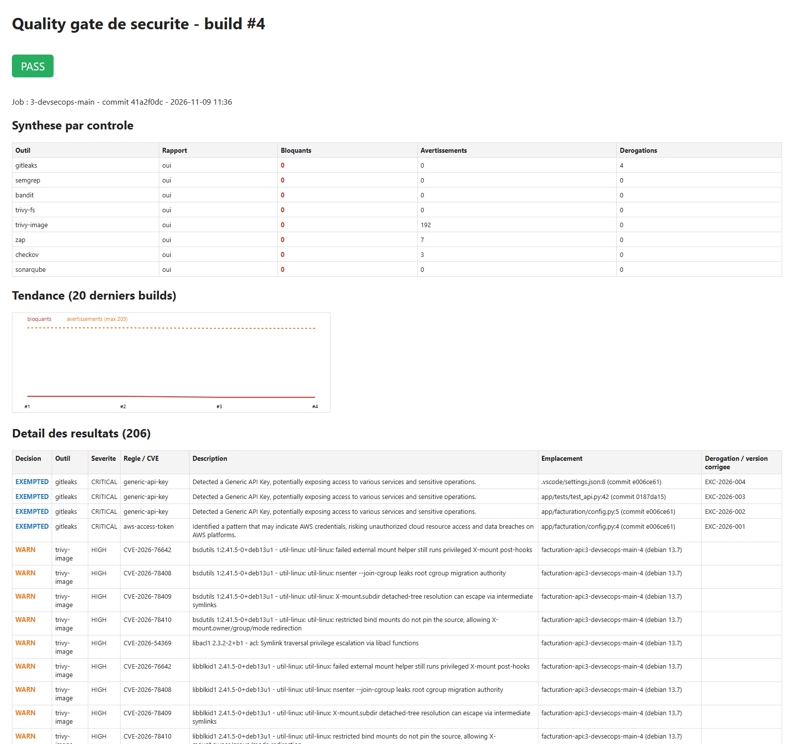
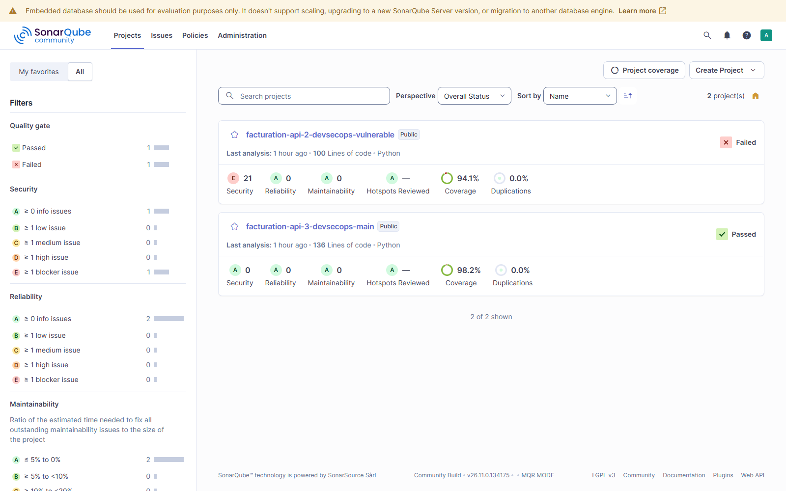
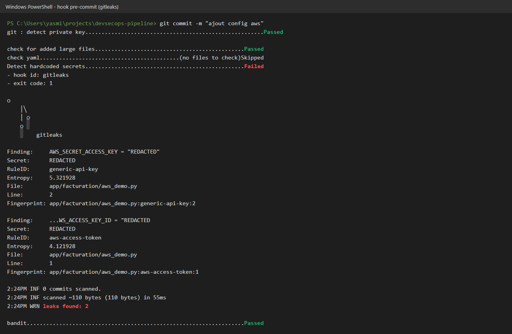

# Demo and verification guide: DevSecOps pipeline

**Purpose:** verify the project live, step by step, in front of the professor, and justify every
technical choice.
**Demo length:** 15 to 20 minutes (part B). Part C is for answering questions.

*Version française : [GUIDE_DEMO.md](GUIDE_DEMO.md)*

Each step gives: **what I do**, **the command**, **the expected result** and **what I say**.
Every command and expected result was tested on the platform on 9 November 2026.

---

## Part A: Before the demo (10 minutes, alone)

### A1. Start the platform

1. Start **Docker Desktop** and wait for the green icon.
2. In PowerShell:

```powershell
cd C:\Users\yasmi\projects\devsecops-pipeline\infra
docker compose up -d
docker start facturation-prod facturation-prod-asis
docker ps --format "{{.Names}}  {{.Status}}"
```

**Expected:** 5 containers `Up`: `jenkins`, `sonarqube`, `mailpit`, `facturation-prod` (fixed
code, port 8081) and `facturation-prod-asis` (vulnerable code, port 8090). SonarQube takes about
2 minutes to start.

### A2. Open the browser tabs

| Tab | Address | Login |
|-----|---------|-------|
| Jenkins | http://localhost:8080 | `admin` + `JENKINS_ADMIN_PASSWORD` from `infra\.env` |
| SonarQube | http://localhost:9000 | `admin` + `SONAR_ADMIN_PASSWORD` from `infra\.env` |
| Mailpit (emails) | http://localhost:8025 | none |

Also open the project in **VS Code** (`code C:\Users\yasmi\projects\devsecops-pipeline`) and a
PowerShell terminal in the project folder.

### A3. Quick check

```powershell
curl.exe -s http://localhost:8081/health
curl.exe -s http://localhost:8090/health
```

**Expected:** `{"status":"ok"}` twice. If a container is missing, see part D.

---

## Part B: Demo script

### Step 1: The platform is entirely "as code" (1 min)

**I show:** `infra/docker-compose.yml`, `infra/jenkins/casc.yaml`, `infra/bootstrap.ps1`.

**I say:** "Nothing was configured by hand. Jenkins, its plugins, credentials, three jobs and the
SonarQube server are described in versioned files. One script rebuilds the whole platform on
another machine."

### Step 2: The problem: the original pipeline deploys a vulnerable application (3 min)

**I show:** in Jenkins, the `1-as-is-pipeline` job is **green**. I open `Jenkinsfile.asis`: four
steps, no controls, and a plaintext password (`DB_PASSWORD`).

**I prove the deployed application can be attacked**, live, on port 8090:

```powershell
$alice = 'alice' + '-demo-key'   # Alice's demo API key (public test data, see db.py)

# 1) BOLA: Alice reads invoice 3, which belongs to Bob
curl.exe -s -H "X-API-Key: $alice" http://localhost:8090/invoices/3

# 2) SQL injection: Alice gets every customer's invoices
curl.exe -s -H "X-API-Key: $alice" "http://localhost:8090/invoices/search?customer=%25'%20OR%201%3D1%20--"

# 3) Command injection, no authentication
curl.exe -s "http://localhost:8090/admin/ping?host=127.0.0.1;id"
```

**Expected:**
1. `{"id":3,"owner_id":2,"customer":"Poulina Group","amount":99000.0}`: Alice reads Bob's invoice.
2. All **3** invoices, including Bob's (`owner_id: 2`).
3. `uid=0(root) gid=0(root)`: the `id` command ran **as root** inside the container.

**I say:** "This pipeline is green, and it just put into production an application where anyone
can run commands as root. That is exactly the problem to solve."

*Expected on screen: the 3 jobs: green / red / green*



### Step 3: The same code through the DevSecOps pipeline is blocked (3 min)

**I show:** the `2-devsecops-vulnerable` job is **red**.

1. Open the job: the *Stage View* shows the scan stages in red. The `deploy_production` column
   never runs.
2. Click the last build, then **Rapports securite** in the left menu.
   - **Quality gate** tab: **BLOCK** verdict, per-tool summary (4 secrets, 3 Semgrep, 2 Bandit,
     14 dependencies, 114 image, 1 ZAP, SonarQube failed), trend chart, then each finding in detail.
   - **ZAP (DAST)** tab: **High** alert *Remote OS Command Injection*. ZAP found the flaw by
     **attacking** the application in staging, not by reading the code.
   - **Trivy (image)** tab: the CVEs of the outdated base image.
3. Optional: **Console Output**, search for `VERDICT : BLOCK`.

**I say:** "The scans keep running even when one fails, so the developer gets the full list in a
single run. The `security_gate` stage makes the final decision and stops the production deploy."

*Expected on screen: job 2 Stage View, production never reached*



*Expected on screen: quality gate report: BLOCK*



*Expected on screen: ZAP report: Remote OS Command Injection (High)*



### Step 4: The fixed code passes and the attacks fail (3 min)

**I show:** the `3-devsecops-main` job is **green** all the way to `deploy_production`.
In **Rapports securite → Quality gate**: **PASS** verdict, 4 tracked exemptions, 192 warnings
(CVEs with no fix available).

**I replay the same attacks** against the fixed production, port 8081:

```powershell
$alice = 'alice' + '-demo-key'   # Alice's demo API key (public test data, see db.py)
curl.exe -s -o NUL -w "%{http_code}\n" -H "X-API-Key: $alice" http://localhost:8081/invoices/3
curl.exe -s -H "X-API-Key: $alice" "http://localhost:8081/invoices/search?customer=%25'%20OR%201%3D1%20--"
curl.exe -s -o NUL -w "%{http_code}\n" "http://localhost:8081/admin/ping?host=127.0.0.1;id"
```

**Expected:** `404` (Bob's invoice is invisible to Alice), `[]` (the parameterised query treats the
injection as plain text), `404` (the dangerous endpoint no longer exists).

**I show the container hardening:**

```powershell
docker inspect facturation-prod --format "user={{.Config.User}} read-only={{.HostConfig.ReadonlyRootfs}} caps-dropped={{.HostConfig.CapDrop}}"
docker inspect facturation-prod-asis --format "user={{.Config.User}} read-only={{.HostConfig.ReadonlyRootfs}}"
```

**Expected:** `user=10001 read-only=true caps-dropped=[ALL]` for the fixed version, and
`user= read-only=false` (so root, writable) for the original.

*Expected on screen: job 3 Stage View, all green*



*Expected on screen: quality gate report: PASS*



### Step 5: Centralisation in SonarQube (2 min)

**I show:** http://localhost:9000/projects

- `facturation-api-2-devsecops-vulnerable`: **Failed**, security rating **E**, 21 vulnerabilities.
- `facturation-api-3-devsecops-main`: **Passed**, rating **A**, 98.2 % coverage.
- In a project, the **Issues** tab also shows the Bandit, Semgrep and Gitleaks results imported by
  the pipeline.
- **Quality Gates** menu: the "DevSecOps" gate (security rating A, coverage ≥ 80 %).

**I say:** "SonarQube is the single dashboard. It holds its own analysis and the other tools'
reports. Exemptions are applied before import, so there is one source of truth."

*Expected on screen: SonarQube: rating E vs rating A*



### Step 6: Notifications and history (1 min)

**I show:**
- Mailpit (http://localhost:8025): a `[BLOQUE]` email listing the blocking findings, and an
  `[OK] … deploye en production` email.
- In the Quality gate report: the trend chart. History is also in Jenkins (30 builds kept) and in
  SonarQube's **Activity** tab.

*Expected on screen: Mailpit: [BLOQUE] and [OK] emails*

![Mailpit: [BLOQUE] and [OK] emails](captures/09-mailpit-alertes.png)

### Step 7: Security on the developer workstation (2 min)

**I do:** in the terminal, at the project root:

```powershell
.\.venv\Scripts\Activate.ps1
$k = 'AKIA' + 'Q7XKJ4WZT2MBN5RD'   # fake key, split in two so the repo itself holds no key
Set-Content -Encoding ascii app\facturation\aws_demo.py "AWS_ACCESS_KEY_ID = `"$k`""
git add app\facturation\aws_demo.py
git commit -m "ajout config aws"
```

**Expected:** `Detect hardcoded secrets ... Failed`, `leaks found: 1`. **The commit is refused**:
the secret never left the machine.

**Clean up:**

```powershell
git reset -q; Remove-Item app\facturation\aws_demo.py
```

**I also show** in VS Code: the recommended extensions (`.vscode/extensions.json`) and SonarLint
connected to the SonarQube server (`.vscode/settings.json`).

**I say:** "The hook can be bypassed with `--no-verify`. That's why the CI re-runs every check. The
workstation speeds up detection; the CI guarantees it."

*Expected on screen: commit refused by the pre-commit hook*



### Step 8: Targeted local scan before push (1 min)

```powershell
powershell -ExecutionPolicy Bypass -File scripts\scan-local.ps1 -Only gitleaks
```

**Expected:** `[OK] gitleaks bloquants=0 ... derogations=4`, `VERDICT : PASS`.
The tools come from the Jenkins image, in the same versions, with the same policy.

### Step 9: An expired exemption blocks again automatically (2 min)

**I do:** in `security/exemptions.yml`, I change the expiry date of `EXC-2026-001` from
`2027-05-09` to `2026-11-01`, save, then:

```powershell
powershell -ExecutionPolicy Bypass -File scripts\scan-local.ps1 -Only gitleaks
```

**Expected:**
`Derogation EXC-2026-001 EXPIREE le 2026-11-01 : le resultat redevient bloquant`, then
`VERDICT : BLOCK`.

**Restore:** `git checkout -- security\exemptions.yml`

**I say:** "An exemption is never permanent. It has an approver, a ticket and an expiry date. When
it expires, the finding blocks again with no human action."

### Step 10: Real time: a vulnerable commit triggers the pipeline and is blocked (5 min, optional)

This is the most convincing demo: one push, no click in Jenkins.

```powershell
Set-Content -Encoding ascii app\facturation\diagnostic.py "import subprocess`n`n`ndef diagnostic(host):`n    return subprocess.run(f`"ping -c 1 {host}`", shell=True)`n"
git add app\facturation\diagnostic.py
git commit -m "ajout diagnostic reseau"
```

1. **The pre-commit hook refuses the commit** (Bandit, High severity). First safety net.
2. I simulate a developer who bypasses the hook:
   `git commit --no-verify -m "ajout diagnostic reseau"`
3. In Jenkins, **within a minute**, the `3-devsecops-main` job starts by itself
   (cause: *Started by an SCM change*).
4. About 2 minutes later the build is **red**: Semgrep and Bandit flag `shell=True`,
   `deploy_production` does not run, and a `[BLOQUE]` email arrives in Mailpit. Production
   (port 8081) stays on the healthy version.
5. **Restore:** `git revert --no-edit HEAD`. The pipeline restarts by itself and turns green.

> Note: I checked that the hook blocks this commit. Steps 2 to 5 rely on the same Semgrep and Bandit
> rules that already block the `vulnerable` branch. The `--no-verify` bypass is yours to run during
> the demo, to show what happens when a developer skips the hook.

### Step 11: Pipeline secrets (1 min)

**I show:**
- Jenkins → *Manage Jenkins* → *Credentials*: the `sonar-token` is stored as a credential. In a
  build log it shows masked (`****`).
- `git check-ignore -v infra/.env`: the password file is excluded from Git.
- `Jenkinsfile`: no password. Compare with `DB_PASSWORD` in plaintext in `Jenkinsfile.asis`.

### Conclusion (30 s)

"The same vulnerable code is green in the original pipeline and blocked in the DevSecOps pipeline.
The fixed code passes and goes to production hardened. Every decision is automatic, measured and
traceable. Accepted limitation: no tool caught the BOLA. The pipeline complements code review; it
does not replace it."

---

## Part C: Why each choice

### C1. Architecture and approach

| Choice | Why | Rejected alternative |
|--------|-----|----------------------|
| **Jenkins** | Required by the brief (Jenkins or GitLab), widely used in companies, plugins for SonarQube, HTML reports, email | GitLab CI: excellent, but heavier to host locally and less control over the platform |
| **Docker Compose** for the platform | Runs on one PC, rebuilt with one command, no cloud account needed | Virtual machines: slow and not reproducible |
| **Configuration as Code** (JCasC + Job DSL) | Reproducible, reviewable platform; no undocumented manual clicks | Manual Jenkins setup: impossible to audit or reproduce |
| **Two branches** (`vulnerable` and `main`) with the **same Jenkinsfile** | Proof by comparison: the controls block bad code **and** let good code through | One branch: only half the proof |
| **A 3rd job running the original pipeline** | Measure the as-is state instead of only describing it | Describing it in the report only |
| A deliberately vulnerable **FastAPI** app | Small, readable, covers OWASP Top 10 flaws (injection, deserialization, secrets, access control) | An existing demo app: less under control, harder to explain |

### C2. The tools

| Control | Tool | Why this one |
|---------|------|--------------|
| Secrets | **Gitleaks** | Scans **the whole Git history**, not just the current code. Fast, SARIF output, and the same tool runs as a pre-commit hook. |
| SAST | **Semgrep** | Ready-made OWASP rules **and** easy custom rules. My two rules found the SQL injection and the `pickle` call that SonarQube Community misses. |
| SAST | **Bandit** | Python specialist, with a **confidence** level per finding, useful to cut false positives. |
| SAST + central dashboard | **SonarQube** Community | Required by the brief. Single dashboard, quality gate, history, and imports the other tools' reports. |
| SCA + image | **Trivy** | One tool for dependencies and the image (OS and Python packages). It reports the **fixed version**, which enables the "block only if a fix exists" rule. |
| SBOM | **Syft** (CycloneDX) | Component inventory, in the standard format expected by the EU Cyber Resilience Act. |
| DAST | **OWASP ZAP**, *API scan* mode | **Active** scan driven by the OpenAPI definition: ZAP knows every endpoint and parameter. The *baseline* mode is passive and would not have found the command injection. |
| IaC | **Checkov** | Covers Dockerfile and Kubernetes with over 1,000 rules. |
| Email | **Mailpit** | Local SMTP server: emails are really sent and viewable, without exposing a mail account. |

**Pinned versions and verified checksum:** security tools are targets too. In March 2026 the
Trivy GitHub Action tags were compromised. A tag can be moved; a pinned version and a checksum
cannot.

### C3. Stage order

| Choice | Why |
|--------|-----|
| Secrets and SAST **first** | Fastest checks (a few seconds): immediate feedback to the developer. |
| Semgrep and Bandit **in parallel** | Independent, so it saves time. |
| Unit tests with **coverage ≥ 80 %** | The security tests (`test_security.py`) are part of the suite: a fixed flaw that comes back breaks the build. |
| Build **after** code analysis | No point building an image if the code is already rejected. |
| DAST on an **isolated staging** | ZAP really attacks the application, so never in production. The staging container is on an internal network and removed after the build. |
| `catchError` on each scan | A red stage doesn't stop the next ones: the developer sees **all** problems at once instead of one at a time. |
| One final **`security_gate`** stage | One decision, made on all the reports, with one policy. |
| `deploy_production` **only if everything passes** | That's what a blocking quality gate means. |
| Trigger **on every commit** (polling every minute) | The repository is local, so no webhook is possible. On GitHub/GitLab a webhook would trigger instantly. |

### C4. Blocking policy

| Choice | Why |
|--------|-----|
| Policy in a **versioned file** (`policy.yml`) applied by **one script** (`gate.py`) | Thresholds are reviewed like code, and every tool is judged with the same logic. Changing a threshold leaves a trace in Git. |
| **Every secret blocks** | A committed secret must be treated as compromised, whatever its "severity". |
| **CVSS ≥ 7** threshold (HIGH and CRITICAL) | Common industry threshold: it matches exploitable, high-impact vulnerabilities. |
| CVE blocks **only if a fix exists** | Blocking on a CVE with no fix allows no action and stalls the team. These CVEs stay visible as warnings. |
| Bandit: HIGH **with confidence ≥ MEDIUM** | Bandit produces low-confidence false positives. Blocking on them causes alert fatigue and pushes people to bypass the tool. |
| ZAP: **High** risk | A High alert in staging is a flaw confirmed **at runtime**. |
| Checkov **non-blocking** | 2–4 week observation period to measure noise before blocking. Harden progressively. |
| **Missing report = failure** | A broken scanner must never let a build through by default. |
| SonarQube: security rating A, coverage ≥ 80 % | Custom "DevSecOps" gate, stricter on security than the default gate. |

### C5. Exemptions

| Choice | Why |
|--------|-----|
| An `exemptions.yml` register instead of disabling a rule | Lifts **one** precise finding (tool, rule, location), not a whole category. |
| Approver, ticket and justification required | Traceability: who accepted which risk, and why. |
| **Mandatory expiry date** | A forgotten exemption would become permanent. On expiry, the finding blocks again (shown in step 9). |
| Same register applied to SonarQube (SARIF filtering) | One source of truth: without it, SonarQube kept failing on an already accepted risk. |
| Historical AWS key: exemption **after revocation** | Deleting the file doesn't remove the secret from Git history. Revoke the key first, then record the exemption and plan the history rewrite. |

### C6. Application fixes

| Flaw | Fix | Why this fix |
|------|-----|--------------|
| SQL injection | Parameterised query | The database gets the data separately from the query, so a quote can no longer change the query. |
| `pickle.loads` | JSON + Pydantic schema | `pickle` can run code during deserialization. JSON carries only data, and Pydantic validates its shape. |
| `shell=True` | No shell, validated input, authenticated endpoint | Without a shell, characters like `;` or `|` mean nothing. |
| MD5 | Salted `scrypt` | MD5 runs billions of times per second. `scrypt` is deliberately slow and memory-hungry. |
| XSS | `html.escape` | User text is displayed as text, never interpreted as HTML. |
| BOLA | `owner_id` filter | Every request checks the invoice belongs to the user. No tool caught it: the fix and test came from code review. |
| Plaintext secrets | Environment variables | The secret is no longer in the code or the image. |
| Each flaw | A regression test | If someone reintroduces the flaw, the `unit_tests` stage fails. |

### C7. Docker image and deployment

| Choice | Why |
|--------|-----|
| Base image **pinned by digest** | A tag (`3.12-slim`) can change; a digest names exactly the same image, bit for bit. |
| **Multi-stage** build | Build tools stay in the build stage: the final image is smaller, with less attack surface. |
| `apt-get upgrade` at build time | Even that day's official image had 2 zlib CVEs fixed in Debian but not yet in the image. |
| User **10001** (non-root) | If the app is compromised, the attacker is not root (compare with `uid=0(root)` in step 2). |
| **Read-only** filesystem and **all capabilities dropped** | The attacker can neither modify files nor use Linux privileges. |
| `HEALTHCHECK` | Docker knows whether the app answers, not just whether the process runs. |
| Image SBOM | When a new CVE comes out, you know in seconds whether the image is affected. |

### C8. Pipeline secrets and developer workstation

| Choice | Why |
|--------|-----|
| SonarQube token as a **Jenkins credential** | Masked in logs, never written in the Jenkinsfile. |
| Passwords **generated** by `bootstrap.ps1` into `infra/.env`, excluded from Git | No default passwords, nothing sensitive in the repository. |
| Pre-commit hooks **pinned by SHA** | Same reason as the tools: an attacker can move a Git tag. |
| Only **fast** checks in pre-commit | Developers disable slow hooks. Heavy scans stay in CI. |
| SonarLint in **connected mode** | The developer sees exactly the CI's rules in the IDE. |
| `scan-local.ps1` using the Jenkins image | Same versions and policy as CI: no surprises after the push. |

### C9. Limitations I acknowledge

- Jenkins can access the host's Docker socket, which equals root on the machine. In production:
  ephemeral agents, rootless Docker or Kaniko.
- SonarQube Community does no data-flow analysis for Python, hence the Semgrep rules.
- 192 CVEs with no fix stay as warnings and must be tracked.
- The Jenkins CSP is relaxed to display HTML reports: not for production.
- The tools did not find the BOLA or the XSS: code review is still essential.

---

## Part D: Troubleshooting

| Problem | Fix |
|---------|-----|
| SonarQube shows "starting" | Wait 2–3 minutes after `docker compose up -d`. |
| A `facturation-prod*` container is missing | In Jenkins, click **Build Now** on job 1 (port 8090) or job 3 (port 8081). |
| The job doesn't start after a commit | Jenkins polls every minute: wait 60 s, or click **Build Now**. |
| Forgot a password | `Get-Content infra\.env` |
| Rebuild everything from scratch | `powershell -ExecutionPolicy Bypass -File infra\bootstrap.ps1` |
| Port 8080 already in use | Close the other application, then `docker compose up -d`. |
