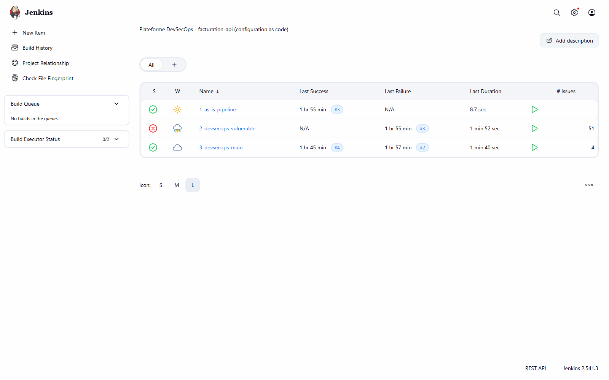
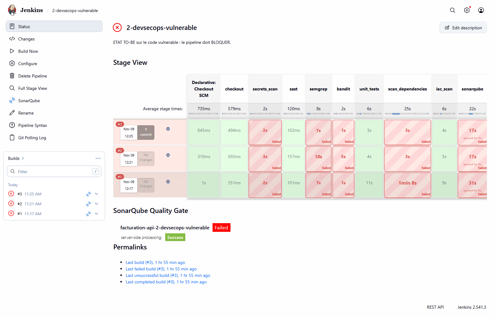
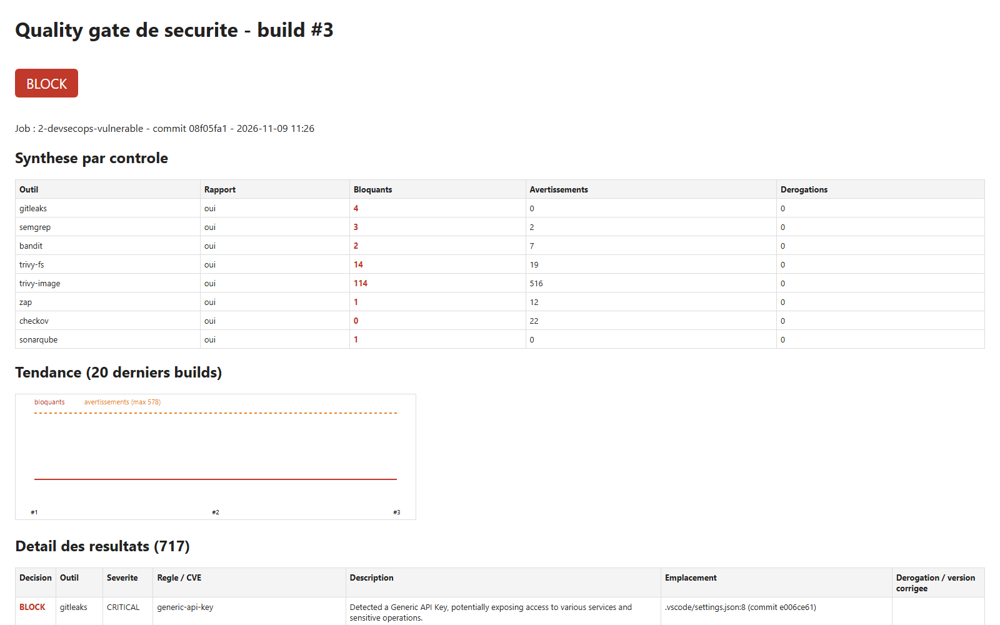
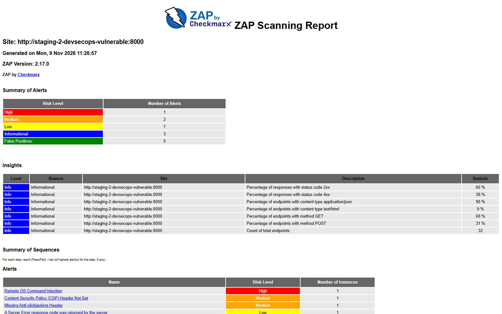
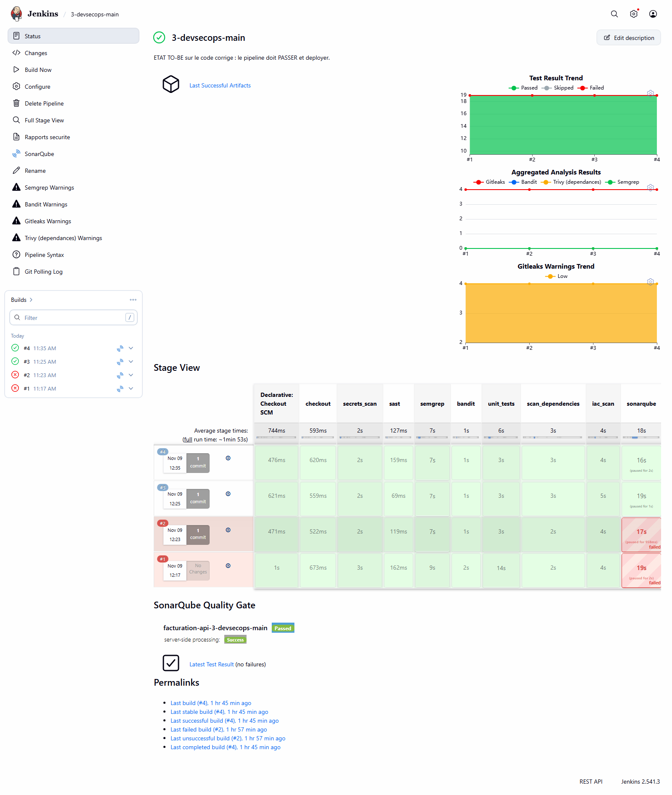
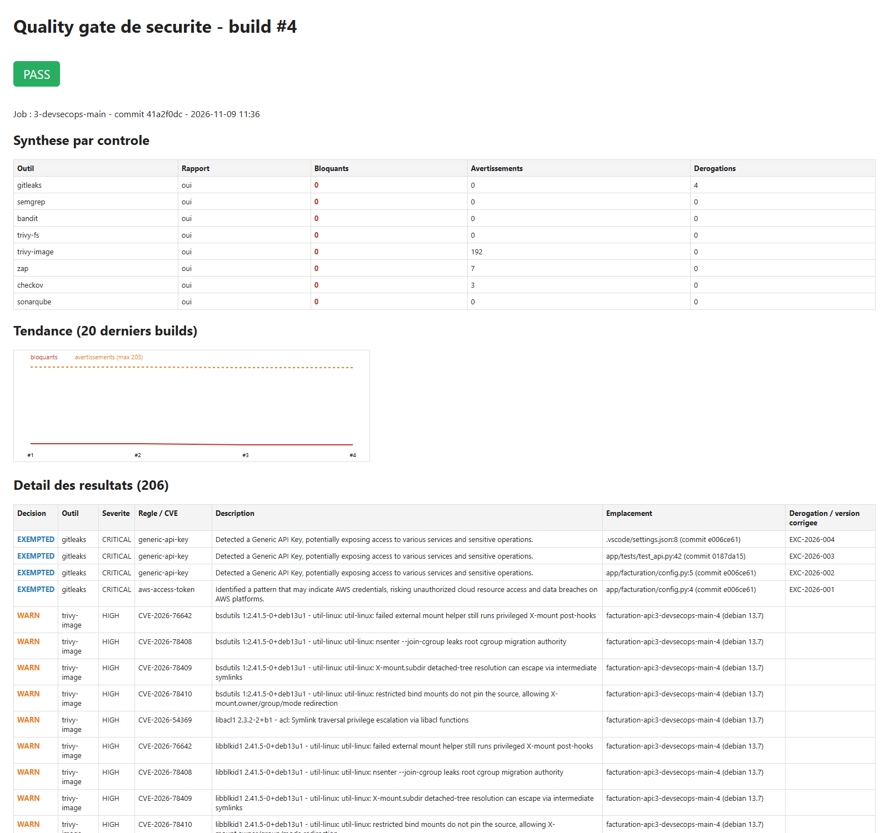
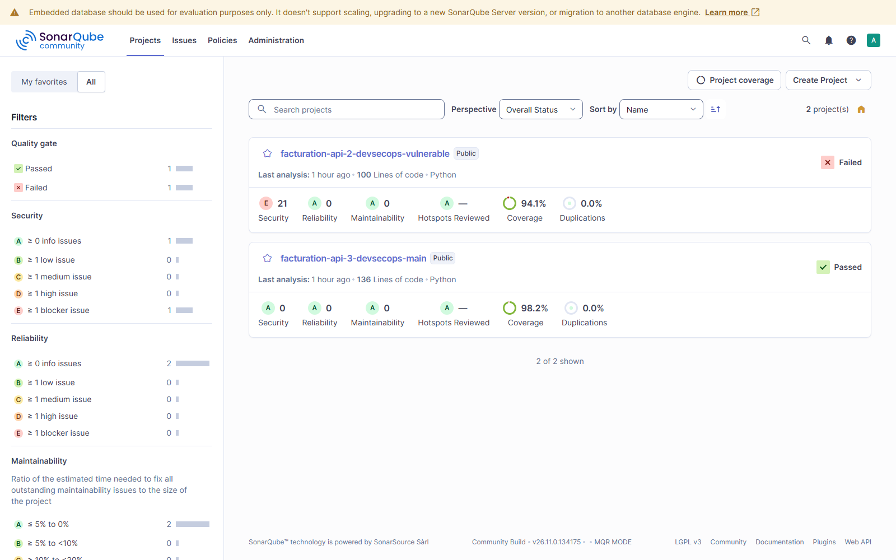
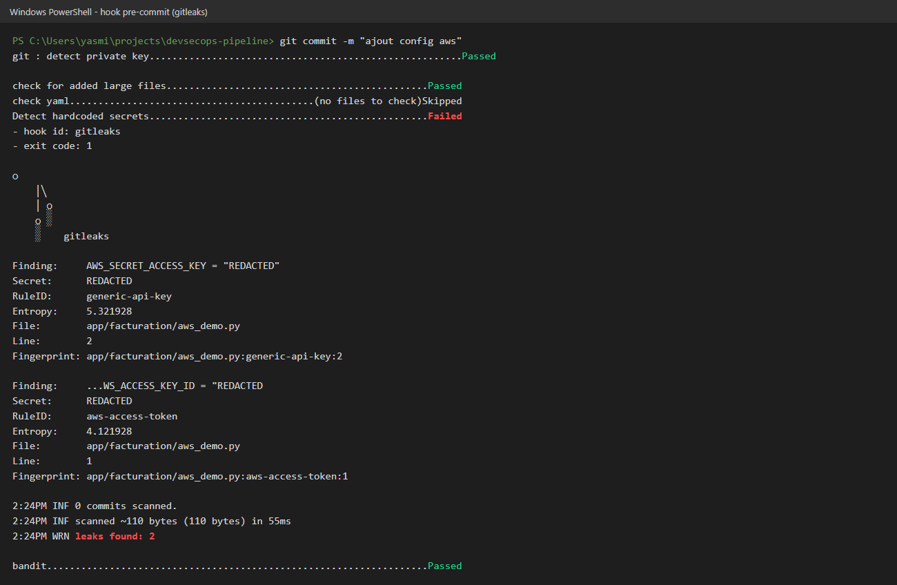

# Guide de démonstration et de vérification — pipeline DevSecOps

**Objet :** vérifier le projet en conditions réelles, étape par étape, devant le professeur, et
justifier chaque choix technique.
**Durée de la démo :** 15 à 20 minutes (partie B). La partie C sert à répondre aux questions.

*English version: [DEMO_GUIDE_EN.md](DEMO_GUIDE_EN.md)*

Chaque étape indique : **ce que je fais**, **la commande**, **le résultat attendu** et **ce que je dis**.
Toutes les commandes et tous les résultats attendus ont été testés sur la plateforme le 9 novembre 2026.

---

## Partie A — Avant la démo (10 minutes, seule)

### A1. Démarrer la plateforme

1. Lancer **Docker Desktop** et attendre que l'icône soit verte.
2. Dans PowerShell :

```powershell
cd C:\Users\yasmi\projects\devsecops-pipeline\infra
docker compose up -d
docker start facturation-prod facturation-prod-asis
docker ps --format "{{.Names}}  {{.Status}}"
```

**Résultat attendu :** 5 conteneurs `Up` : `jenkins`, `sonarqube`, `mailpit`, `facturation-prod`
(le code corrigé, port 8081) et `facturation-prod-asis` (le code vulnérable, port 8090).
SonarQube met environ 2 minutes à démarrer.

### A2. Ouvrir les onglets du navigateur

| Onglet | Adresse | Connexion |
|--------|---------|-----------|
| Jenkins | http://localhost:8080 | `admin` + mot de passe `JENKINS_ADMIN_PASSWORD` dans `infra\.env` |
| SonarQube | http://localhost:9000 | `admin` + mot de passe `SONAR_ADMIN_PASSWORD` dans `infra\.env` |
| Mailpit (e-mails) | http://localhost:8025 | aucune |

Ouvrir aussi le projet dans **VS Code** (`code C:\Users\yasmi\projects\devsecops-pipeline`) et
un terminal PowerShell placé dans le dossier du projet.

### A3. Vérification rapide

```powershell
curl.exe -s http://localhost:8081/health
curl.exe -s http://localhost:8090/health
```

**Résultat attendu :** `{"status":"ok"}` deux fois. Si un conteneur manque, voir la partie D.

---

## Partie B — Scénario de démonstration

### Étape 1 — La plateforme est entièrement « as code » (1 min)

**Je montre :** `infra/docker-compose.yml`, `infra/jenkins/casc.yaml`, `infra/bootstrap.ps1`.

**Je dis :** « Rien n'a été configuré à la main. Jenkins, ses plugins, ses identifiants, ses trois
jobs et le serveur SonarQube sont décrits dans des fichiers versionnés. Un seul script recrée
toute la plateforme sur un autre poste. »

### Étape 2 — Le problème : le pipeline d'origine déploie une application vulnérable (3 min)

**Je montre :** dans Jenkins, le job `1-as-is-pipeline` est **vert**. J'ouvre `Jenkinsfile.asis` :
quatre étapes, aucun contrôle, et un mot de passe en clair (`DB_PASSWORD`).

**Je prouve que l'application déployée est attaquable**, en direct, sur le port 8090 :

```powershell
$alice = 'alice' + '-demo-key'   # cle API de demo d'Alice (donnees de test publiques, voir db.py)

# 1) BOLA : Alice lit la facture n°3, qui appartient à Bob
curl.exe -s -H "X-API-Key: $alice" http://localhost:8090/invoices/3

# 2) Injection SQL : Alice récupère les factures de tous les clients
curl.exe -s -H "X-API-Key: $alice" "http://localhost:8090/invoices/search?customer=%25'%20OR%201%3D1%20--"

# 3) Injection de commande, sans authentification
curl.exe -s "http://localhost:8090/admin/ping?host=127.0.0.1;id"
```

**Résultats attendus :**
1. `{"id":3,"owner_id":2,"customer":"Poulina Group","amount":99000.0}` : Alice lit une facture de Bob.
2. Les **3** factures, dont celle de Bob (`owner_id: 2`).
3. `uid=0(root) gid=0(root)` : la commande `id` s'est exécutée **en root** dans le conteneur.

**Je dis :** « Ce pipeline est vert, et il vient de mettre en production une application où
n'importe qui exécute des commandes en root. C'est exactement le problème à résoudre. »

*Résultat attendu à l'écran : les 3 jobs : vert / rouge / vert*



### Étape 3 — Le même code passe dans le pipeline DevSecOps : il est bloqué (3 min)

**Je montre :** le job `2-devsecops-vulnerable` est **rouge**.

1. Ouvrir le job : la *Stage View* montre les stages de scan en rouge. La colonne
   `deploy_production` n'est jamais exécutée.
2. Cliquer sur le dernier build, puis **Rapports securite** dans le menu de gauche.
   - Onglet **Quality gate** : verdict **BLOCK**, synthèse par outil (4 secrets, 3 Semgrep,
     2 Bandit, 14 dépendances, 114 image, 1 ZAP, SonarQube en échec), courbe de tendance,
     puis le détail de chaque résultat.
   - Onglet **ZAP (DAST)** : alerte **High** *Remote OS Command Injection*. ZAP a trouvé la faille
     en **attaquant** l'application en staging, pas en lisant le code.
   - Onglet **Trivy (image)** : les CVE de l'image de base obsolète.
3. Optionnel : **Console Output**, chercher `VERDICT : BLOCK`.

**Je dis :** « Les scans continuent même quand l'un échoue : le développeur reçoit la liste
complète en une seule exécution. C'est le stage `security_gate` qui prend la décision finale et
empêche la mise en production. »

*Résultat attendu à l'écran : Stage View du job 2, production jamais atteinte*



*Résultat attendu à l'écran : rapport du quality gate : BLOCK*



*Résultat attendu à l'écran : rapport ZAP : Remote OS Command Injection (High)*



### Étape 4 — Le code corrigé passe et les attaques échouent (3 min)

**Je montre :** le job `3-devsecops-main` est **vert** jusqu'à `deploy_production`.
Dans **Rapports securite → Quality gate** : verdict **PASS**, 4 dérogations tracées,
192 avertissements (CVE sans correctif disponible).

**Je rejoue les mêmes attaques** sur la production corrigée, port 8081 :

```powershell
$alice = 'alice' + '-demo-key'   # cle API de demo d'Alice (donnees de test publiques, voir db.py)
curl.exe -s -o NUL -w "%{http_code}\n" -H "X-API-Key: $alice" http://localhost:8081/invoices/3
curl.exe -s -H "X-API-Key: $alice" "http://localhost:8081/invoices/search?customer=%25'%20OR%201%3D1%20--"
curl.exe -s -o NUL -w "%{http_code}\n" "http://localhost:8081/admin/ping?host=127.0.0.1;id"
```

**Résultats attendus :** `404` (la facture de Bob est invisible pour Alice), `[]` (la requête
paramétrée traite l'injection comme un simple texte), `404` (l'endpoint dangereux n'existe plus).

**Je montre le durcissement du conteneur :**

```powershell
docker inspect facturation-prod --format "user={{.Config.User}} lecture-seule={{.HostConfig.ReadonlyRootfs}} capacites-retirees={{.HostConfig.CapDrop}}"
docker inspect facturation-prod-asis --format "user={{.Config.User}} lecture-seule={{.HostConfig.ReadonlyRootfs}}"
```

**Résultat attendu :** `user=10001 lecture-seule=true capacites-retirees=[ALL]` pour la version
corrigée, et `user= lecture-seule=false` (donc root, modifiable) pour la version d'origine.

*Résultat attendu à l'écran : Stage View du job 3, tout vert*



*Résultat attendu à l'écran : rapport du quality gate : PASS*



### Étape 5 — Centralisation dans SonarQube (2 min)

**Je montre :** http://localhost:9000/projects

- `facturation-api-2-devsecops-vulnerable` : **Failed**, note de sécurité **E**, 21 vulnérabilités.
- `facturation-api-3-devsecops-main` : **Passed**, note **A**, couverture 98,2 %.
- Dans un projet, onglet **Issues** : on y voit aussi les résultats de Bandit, Semgrep et Gitleaks,
  importés par le pipeline.
- Menu **Quality Gates** : le gate « DevSecOps » (note de sécurité A, couverture ≥ 80 %).

**Je dis :** « SonarQube est le tableau de bord unique. Il reçoit sa propre analyse et les
rapports des autres outils. Les dérogations sont appliquées avant l'import : une seule source de
vérité. »

*Résultat attendu à l'écran : SonarQube : note E contre note A*



### Étape 6 — Notifications et historique (1 min)

**Je montre :**
- Mailpit (http://localhost:8025) : un e-mail `[BLOQUE]` avec la liste des résultats bloquants,
  et un e-mail `[OK] … deploye en production`.
- Dans le rapport Quality gate : la courbe de tendance. L'historique est aussi dans
  Jenkins (30 builds conservés) et dans l'onglet **Activity** de SonarQube.

*Résultat attendu à l'écran : Mailpit : e-mails [BLOQUE] et [OK]*

![Mailpit : e-mails [BLOQUE] et [OK]](captures/09-mailpit-alertes.png)

### Étape 7 — Sécurité sur le poste du développeur (2 min)

**Je fais :** dans le terminal, à la racine du projet :

```powershell
.\.venv\Scripts\Activate.ps1
$k = 'AKIA' + 'Q7XKJ4WZT2MBN5RD'   # fausse cle, coupee en deux : le depot ne contient aucune cle
Set-Content -Encoding ascii app\facturation\aws_demo.py "AWS_ACCESS_KEY_ID = `"$k`""
git add app\facturation\aws_demo.py
git commit -m "ajout config aws"
```

**Résultat attendu :** `Detect hardcoded secrets ... Failed`, `leaks found: 1`. **Le commit est
refusé** : le secret n'a jamais quitté le poste.

**Nettoyer :**

```powershell
git reset -q; Remove-Item app\facturation\aws_demo.py
```

**Je montre aussi** dans VS Code : les extensions recommandées (`.vscode/extensions.json`) et la
connexion SonarLint au serveur SonarQube (`.vscode/settings.json`).

**Je dis :** « Le hook peut être contourné avec `--no-verify`. C'est pour cela que la CI rejoue
tous les contrôles. Le poste accélère la détection, la CI la garantit. »

*Résultat attendu à l'écran : commit refusé par le hook pre-commit*



### Étape 8 — Scan ciblé en local avant le push (1 min)

```powershell
powershell -ExecutionPolicy Bypass -File scripts\scan-local.ps1 -Only gitleaks
```

**Résultat attendu :** `[OK] gitleaks bloquants=0 ... derogations=4`, `VERDICT : PASS`.
Les outils sont ceux de l'image Jenkins, dans les mêmes versions, avec la même politique.

### Étape 9 — Une dérogation expirée rebloque automatiquement (2 min)

**Je fais :** dans `security/exemptions.yml`, je change la date d'expiration de `EXC-2026-001`
de `2027-05-09` en `2026-11-01`, j'enregistre, puis :

```powershell
powershell -ExecutionPolicy Bypass -File scripts\scan-local.ps1 -Only gitleaks
```

**Résultat attendu :**
`Derogation EXC-2026-001 EXPIREE le 2026-11-01 : le resultat redevient bloquant`, puis
`VERDICT : BLOCK`.

**Remettre en état :** `git checkout -- security\exemptions.yml`

**Je dis :** « Une dérogation n'est jamais permanente. Elle a un approbateur, un ticket et une
date d'expiration. À l'expiration, le résultat redevient bloquant sans intervention humaine. »

### Étape 10 — En temps réel : un commit vulnérable déclenche le pipeline et est bloqué (5 min, optionnelle)

C'est la démonstration la plus parlante : un push, sans aucun clic dans Jenkins.

```powershell
Set-Content -Encoding ascii app\facturation\diagnostic.py "import subprocess`n`n`ndef diagnostic(host):`n    return subprocess.run(f`"ping -c 1 {host}`", shell=True)`n"
git add app\facturation\diagnostic.py
git commit -m "ajout diagnostic reseau"
```

1. **Le hook pre-commit refuse le commit** (Bandit, sévérité High). Premier filet de sécurité.
2. Je simule un développeur qui contourne le hook :
   `git commit --no-verify -m "ajout diagnostic reseau"`
3. Dans Jenkins, **en moins d'une minute**, le job `3-devsecops-main` démarre seul
   (cause : *Started by an SCM change*).
4. Environ 2 minutes plus tard : le build est **rouge**, Semgrep et Bandit signalent `shell=True`,
   le stage `deploy_production` n'est pas exécuté, et un e-mail `[BLOQUE]` arrive dans Mailpit.
   La production (port 8081) reste sur la version saine.
5. **Remettre en état :** `git revert --no-edit HEAD`. Le pipeline repart seul et redevient vert.

> Note : j'ai vérifié que le hook bloque ce commit. Les étapes 2 à 5 reposent sur les mêmes règles
> Semgrep et Bandit qui bloquent déjà la branche `vulnerable`. Le contournement `--no-verify` doit
> être fait par vous, pendant la démo, pour illustrer le cas d'un développeur qui contourne le hook.

### Étape 11 — Les secrets du pipeline (1 min)

**Je montre :**
- Jenkins → *Manage Jenkins* → *Credentials* : le jeton `sonar-token` est stocké comme credential.
  Dans un log de build, il apparaît masqué (`****`).
- `git check-ignore -v infra/.env` : le fichier des mots de passe est exclu de Git.
- `Jenkinsfile` : aucun mot de passe. À comparer avec `DB_PASSWORD` en clair dans `Jenkinsfile.asis`.

### Conclusion (30 s)

« Le même code vulnérable est vert dans le pipeline d'origine et bloqué dans le pipeline DevSecOps.
Le code corrigé passe et part en production durci. Chaque décision est automatique, mesurée et
traçable. Limite assumée : le BOLA n'a été détecté par aucun outil. Le pipeline complète la revue
de code, il ne la remplace pas. »

---

## Partie C — Pourquoi chaque choix

### C1. Architecture et démarche

| Choix | Pourquoi | Alternative écartée |
|-------|----------|---------------------|
| **Jenkins** | Demandé dans le sujet (Jenkins ou GitLab), très répandu en entreprise, plugins pour SonarQube, rapports HTML, e-mail | GitLab CI : excellent, mais plus lourd à héberger en local et moins de contrôle sur la plateforme |
| **Docker Compose** pour la plateforme | Tout tient sur un PC, se recrée en une commande, pas de compte cloud nécessaire | Machines virtuelles : lentes et non reproductibles |
| **Configuration as Code** (JCasC + Job DSL) | Plateforme reproductible et relisible ; aucun clic manuel non documenté | Configuration manuelle de Jenkins : impossible à auditer ou à reproduire |
| **Deux branches** (`vulnerable` et `main`) avec le **même Jenkinsfile** | Preuve par comparaison : on montre que les contrôles bloquent le mauvais code **et** laissent passer le bon | Une seule branche : on ne prouverait que la moitié |
| **Un 3e job avec le pipeline d'origine** | Mesurer l'état *as-is* au lieu de le décrire | Le décrire seulement dans le rapport |
| **Application FastAPI** volontairement vulnérable | Petite, lisible, couvre les failles du Top 10 OWASP (injection, désérialisation, secrets, contrôle d'accès) | Une application de démonstration existante : moins maîtrisée, plus difficile à expliquer |

### C2. Les outils

| Contrôle | Outil | Pourquoi celui-ci |
|----------|-------|-------------------|
| Secrets | **Gitleaks** | Analyse **tout l'historique Git**, pas seulement le code actuel. Rapide, sortie SARIF, et le même outil sert en pre-commit. |
| SAST | **Semgrep** | Règles OWASP prêtes à l'emploi **et** règles personnalisées faciles à écrire. Mes deux règles ont trouvé l'injection SQL et le `pickle` que SonarQube Community ne voit pas. |
| SAST | **Bandit** | Spécialiste Python, avec un niveau de **confiance** par résultat, utile pour réduire les faux positifs. |
| SAST + centralisation | **SonarQube** Community | Exigé par le sujet. Tableau de bord unique, quality gate, historique, et import des rapports des autres outils. |
| SCA + image | **Trivy** | Un seul outil pour les dépendances et l'image (paquets OS et Python). Il indique la **version corrigée**, ce qui permet la règle « bloquer seulement si un correctif existe ». |
| SBOM | **Syft** (CycloneDX) | Inventaire des composants, format standard attendu par le Cyber Resilience Act européen. |
| DAST | **OWASP ZAP**, mode *API scan* | Scan **actif** guidé par la définition OpenAPI : ZAP connaît tous les endpoints et leurs paramètres. Le mode *baseline* est passif et n'aurait pas trouvé l'injection de commande. |
| IaC | **Checkov** | Couvre Dockerfile et Kubernetes avec plus de 1 000 règles. |
| E-mail | **Mailpit** | Serveur SMTP local : les e-mails sont réellement envoyés et consultables, sans exposer de compte de messagerie. |

**Versions épinglées et checksum vérifié :** les outils de sécurité sont eux-mêmes une cible. En
mars 2026, les tags de l'action GitHub de Trivy ont été compromis. Un tag peut être déplacé, une
version figée et un checksum non.

### C3. L'ordre des stages

| Choix | Pourquoi |
|-------|----------|
| Secrets et SAST **en premier** | Ce sont les contrôles les plus rapides (quelques secondes) : retour immédiat au développeur. |
| Semgrep et Bandit **en parallèle** | Ils sont indépendants : on gagne du temps. |
| Tests unitaires avec **couverture ≥ 80 %** | Les tests de sécurité (`test_security.py`) font partie des tests : une faille corrigée qui revient casse le build. |
| Build **après** les analyses du code | Inutile de construire une image si le code est déjà refusé. |
| DAST sur un **staging isolé** | ZAP attaque réellement l'application : jamais en production. Le conteneur de staging est sur un réseau interne et supprimé après le build. |
| `catchError` sur chaque scan | Un stage rouge n'arrête pas les suivants : le développeur voit **tous** les problèmes en une fois au lieu de les découvrir un par un. |
| Un stage **`security_gate`** final unique | Une seule décision, prise sur l'ensemble des rapports, avec une seule politique. |
| `deploy_production` **seulement si tout est conforme** | C'est la définition même d'un quality gate bloquant. |
| Déclenchement **à chaque commit** (scrutation chaque minute) | Le dépôt est local, donc pas de webhook possible. Sur GitHub/GitLab, un webhook déclencherait le build instantanément. |

### C4. La politique de blocage

| Choix | Pourquoi |
|-------|----------|
| Politique dans un **fichier versionné** (`policy.yml`) appliqué par **un seul script** (`gate.py`) | Les seuils sont relus comme du code, et chaque outil est jugé avec la même logique. Changer un seuil laisse une trace dans Git. |
| **Tout secret bloque** | Un secret commité doit être considéré comme compromis, quelle que soit sa « sévérité ». |
| Seuil **CVSS ≥ 7** (HIGH et CRITICAL) | Seuil courant dans l'industrie : il correspond aux vulnérabilités exploitables à fort impact. |
| CVE bloquante **seulement si un correctif existe** | Bloquer sur une CVE sans correctif n'offre aucune action possible et paralyse l'équipe. Ces CVE restent visibles en avertissement. |
| Bandit : HIGH **avec confiance ≥ MEDIUM** | Bandit produit des faux positifs à faible confiance. Bloquer dessus créerait une fatigue d'alertes et pousserait à contourner l'outil. |
| ZAP : risque **High** | Une alerte High en staging est une faille confirmée **à l'exécution**. |
| Checkov **non bloquant** | Phase d'observation de 2 à 4 semaines pour mesurer le bruit avant de bloquer. On durcit progressivement. |
| **Rapport absent = échec** | Un scanner en panne ne doit jamais laisser passer un build par défaut. |
| SonarQube : note de sécurité A, couverture ≥ 80 % | Gate personnalisé « DevSecOps » : plus exigeant sur la sécurité que le gate par défaut. |

### C5. Dérogations

| Choix | Pourquoi |
|-------|----------|
| Registre `exemptions.yml` plutôt que désactiver une règle | On lève **un** résultat précis (outil, règle, emplacement), pas une catégorie entière. |
| Approbateur, ticket et justification obligatoires | Traçabilité : on sait qui a accepté quel risque, et pourquoi. |
| **Date d'expiration obligatoire** | Une dérogation oubliée deviendrait permanente. À l'expiration, le résultat rebloque (démontré à l'étape 9). |
| Même registre appliqué à SonarQube (filtrage SARIF) | Une seule source de vérité : sans cela, SonarQube restait en échec pour un risque déjà accepté. |
| Clé AWS historique : dérogation **après révocation** | Supprimer le fichier ne retire pas le secret de l'historique Git. On révoque d'abord la clé, puis on trace la dérogation et on planifie la réécriture de l'historique. |

### C6. Corrections de l'application

| Faille | Correctif | Pourquoi ce correctif |
|--------|-----------|------------------------|
| Injection SQL | Requête paramétrée | La base reçoit la donnée séparément de la requête : une apostrophe ne peut plus changer la requête. |
| `pickle.loads` | JSON + schéma Pydantic | `pickle` peut exécuter du code à la désérialisation. JSON ne transporte que des données, et Pydantic valide leur forme. |
| `shell=True` | Plus de shell, entrée validée, endpoint authentifié | Sans shell, les caractères `;` ou `|` n'ont plus de sens. |
| MD5 | `scrypt` salé | MD5 se calcule des milliards de fois par seconde. `scrypt` est volontairement lent et coûteux en mémoire. |
| XSS | `html.escape` | Le texte de l'utilisateur est affiché comme texte, jamais interprété comme HTML. |
| BOLA | Filtre `owner_id` | Chaque requête vérifie que la facture appartient à l'utilisateur. Aucun outil ne l'a détecté : correctif et test écrits après revue de code. |
| Secrets en clair | Variables d'environnement | Le secret n'est plus dans le code ni dans l'image. |
| Chaque faille | Un test de non-régression | Si quelqu'un réintroduit la faille, le stage `unit_tests` échoue. |

### C7. Image Docker et déploiement

| Choix | Pourquoi |
|-------|----------|
| Image de base **épinglée par digest** | Un tag (`3.12-slim`) peut changer ; un digest désigne exactement la même image, bit pour bit. |
| **Multi-étapes** | Les outils de compilation restent dans l'étape de build : l'image finale est plus petite, avec moins de surface d'attaque. |
| `apt-get upgrade` au build | Même l'image officielle du jour avait 2 CVE zlib corrigées dans Debian mais pas encore dans l'image. |
| Utilisateur **10001** (non root) | Si l'application est compromise, l'attaquant n'est pas root (comparer avec `uid=0(root)` à l'étape 2). |
| Système de fichiers **en lecture seule** et **toutes les capacités retirées** | L'attaquant ne peut ni modifier les fichiers ni utiliser de privilèges Linux. |
| `HEALTHCHECK` | Docker sait si l'application répond, pas seulement si le processus tourne. |
| SBOM de l'image | Quand une nouvelle CVE sort, on sait en quelques secondes si l'image est concernée. |

### C8. Secrets du pipeline et poste développeur

| Choix | Pourquoi |
|-------|----------|
| Jeton SonarQube en **credential Jenkins** | Masqué dans les logs, jamais écrit dans le Jenkinsfile. |
| Mots de passe **générés** par `bootstrap.ps1` dans `infra/.env` exclu de Git | Pas de mot de passe par défaut, rien de sensible dans le dépôt. |
| Hooks pre-commit **épinglés par SHA** | Même raison que les outils : un tag Git peut être déplacé par un attaquant. |
| Seulement des contrôles **rapides** en pre-commit | Un hook lent est désactivé par les développeurs. Les scans lourds restent en CI. |
| SonarLint en **mode connecté** | Le développeur voit dans l'IDE exactement les règles de la CI. |
| `scan-local.ps1` avec l'image Jenkins | Mêmes versions et même politique qu'en CI : pas de surprise après le push. |

### C9. Limites que j'assume

- Jenkins accède au socket Docker de l'hôte : c'est équivalent à un accès root sur la machine.
  En production, il faudrait des agents éphémères, Docker rootless ou Kaniko.
- SonarQube Community ne fait pas d'analyse de flux en Python : d'où les règles Semgrep.
- 192 CVE sans correctif restent en avertissement et doivent être suivies.
- La CSP de Jenkins est assouplie pour afficher les rapports HTML : à ne pas faire en production.
- Les outils n'ont pas trouvé le BOLA ni le XSS : la revue de code reste indispensable.

---

## Partie D — Dépannage

| Problème | Solution |
|----------|----------|
| SonarQube affiche « starting » | Attendre 2 à 3 minutes après `docker compose up -d`. |
| Un conteneur `facturation-prod*` est absent | Dans Jenkins, cliquer sur **Build Now** sur le job 1 (port 8090) ou 3 (port 8081). |
| Le job ne démarre pas après un commit | Jenkins scrute le dépôt chaque minute : attendre 60 s, ou cliquer sur **Build Now**. |
| Mot de passe oublié | `Get-Content infra\.env` |
| Tout reconstruire de zéro | `powershell -ExecutionPolicy Bypass -File infra\bootstrap.ps1` |
| Le port 8080 est déjà utilisé | Fermer l'autre application, puis `docker compose up -d`. |
