# Rapport de projet — Sécurisation d'un pipeline CI/CD (DevSecOps)

**Projet :** facturation-api — intégration de contrôles de sécurité automatisés, du poste développeur à la production
**Date :** 9 novembre 2026
**Outils :** Jenkins, SonarQube, Gitleaks, Semgrep, Bandit, Trivy, Syft, OWASP ZAP, Checkov, pre-commit, Mailpit

---

## Sommaire

1. Contexte et objectifs
2. Méthodologie
3. Analyse du pipeline existant (état *as-is*)
4. Sécurité côté développeur (*shift-left*)
5. Contrôles automatisés dans le pipeline (état *to-be*)
6. Quality gates : seuils de blocage et justification
7. Gestion des secrets du pipeline
8. Reporting, alerting et historisation
9. Résultats obtenus
10. Procédure de dérogation
11. Difficultés rencontrées
12. Limites et axes d'amélioration
13. Annexes (reproduire le projet, captures)

---

## 1. Contexte et objectifs

`facturation-api` est une API REST de facturation (Python 3.12, FastAPI, SQLite), conteneurisée
avec Docker. Elle était livrée par un pipeline Jenkins « DevOps » classique : tests, build,
déploiement — **sans aucun contrôle de sécurité**.

Objectifs du projet :

- intégrer dans le pipeline des contrôles automatisés : **secrets, SAST, SCA, scan d'image Docker,
  DAST**, et en complément **IaC** et **SBOM** ;
- définir des **quality gates** qui bloquent automatiquement toute vulnérabilité critique avant la production ;
- équiper le **poste développeur** pour détecter les failles avant même le commit (*shift-left*) ;
- produire des **rapports**, des **notifications** et un **historique** exploitables par une équipe tierce ;
- documenter une **procédure de dérogation** traçable.

## 2. Méthodologie

1. **État des lieux** : cartographie du pipeline d'origine (`Jenkinsfile.asis`) et de ses faiblesses.
2. **Conception de l'état cible** : choix des outils par catégorie, ordre des stages, politique de blocage.
3. **Plateforme reproductible** : Jenkins + SonarQube + Mailpit en Docker, configurés **entièrement
   en code** (Jenkins Configuration as Code, script `infra/bootstrap.ps1`).
4. **Démonstration par comparaison** : le même pipeline DevSecOps est exécuté sur deux branches :
   - `vulnerable` : le code d'origine (état *as-is*) → le pipeline **doit bloquer** ;
   - `main` : le code corrigé → le pipeline **doit passer** et déployer.
5. **Correction** des vulnérabilités, avec un **test de non-régression** pour chacune.
6. **Mesure** : chaque résultat chiffré de ce rapport provient des builds Jenkins réels (rapports archivés).

Trois jobs Jenkins sont créés automatiquement :

| Job | Branche | Jenkinsfile | Rôle |
|-----|---------|-------------|------|
| `1-as-is-pipeline` | vulnerable | `Jenkinsfile.asis` | référence : pipeline d'origine |
| `2-devsecops-vulnerable` | vulnerable | `Jenkinsfile` | preuve que les contrôles **bloquent** |
| `3-devsecops-main` | main | `Jenkinsfile` | preuve que le code corrigé **passe** |

## 3. Analyse du pipeline existant (*as-is*)

### 3.1 Cartographie

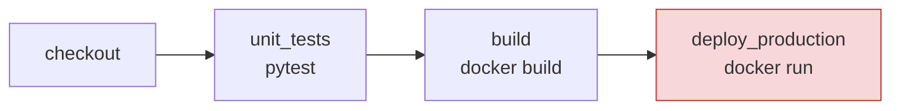

| Étape | Outil | Contrôle de sécurité |
|-------|-------|----------------------|
| CI/CD | Jenkins (pipeline déclaratif) | — |
| Compilation / dépendances | pip | aucun (dépendances non vérifiées) |
| Tests unitaires | pytest | tests fonctionnels uniquement |
| Build / packaging | Docker | aucun scan d'image |
| Déploiement | `docker run` direct en production | aucune validation, pas de staging |

### 3.2 Faiblesses identifiées

| # | Faiblesse | Où | Conséquence |
|---|-----------|-----|-------------|
| W1 | **Secrets en clair dans le code** (clé AWS, mot de passe BD) | `config.py` | compromission du compte cloud ; le secret reste dans l'historique Git |
| W2 | **Aucune analyse du code** (SAST) | pipeline | injection SQL, injection de commande, désérialisation `pickle` livrées en production |
| W3 | **Dépendances non vérifiées** (SCA) | `requirements.txt` | PyJWT 2.3.0, urllib3 1.26.4 : CVE connues et corrigées depuis longtemps |
| W4 | **Image Docker non scannée**, base obsolète non épinglée (`python:3.12.0-slim`, Debian 12.2) | `Dockerfile` | 114 CVE HIGH/CRITICAL corrigeables ; conteneur exécuté en **root** |
| W5 | **Secret en clair dans le pipeline** (`DB_PASSWORD` dans le Jenkinsfile) | `Jenkinsfile.asis` | visible par toute personne lisant le dépôt ou les logs |
| W6 | **Déploiement direct en production** sans staging ni test dynamique | pipeline | aucune détection des failles visibles uniquement à l'exécution |
| W7 | **Aucun contrôle local** (IDE, pre-commit) | poste développeur | les failles sont découvertes tard, donc coûteuses |
| W8 | **Aucun rapport, alerte ni historique** sécurité | pipeline | pas de visibilité, pas de suivi de tendance |
| W9 | **Infrastructure as code non vérifiée** (conteneur `privileged`, image `latest`) | `k8s/deployment.yaml` | élévation de privilèges sur le cluster |

**Mesure de référence :** le job `1-as-is-pipeline` est **vert** et déploie en production une
application contenant toutes ces failles. C'est exactement le problème à résoudre.

## 4. Sécurité côté développeur (*shift-left*)

### 4.1 IDE sécurisé (VS Code)

Le fichier `.vscode/extensions.json` fait proposer automatiquement à chaque développeur :

| Extension | Rôle |
|-----------|------|
| **SonarLint** (connected mode) | mêmes règles que le SonarQube de la CI, affichées en temps réel dans l'éditeur, avec explication de la faille |
| **Semgrep** | mêmes règles personnalisées que la CI (`security/semgrep/`) |
| Python, Docker, YAML | support du langage, du Dockerfile et des manifestes |

Le *connected mode* de SonarLint (`.vscode/settings.json`) garantit qu'un développeur voit dans
l'IDE **exactement** ce que la CI lui reprochera, avec l'explication et le correctif proposé.

### 4.2 Hooks pre-commit

`.pre-commit-config.yaml` bloque le commit **sur le poste**, avant qu'il ne quitte la machine :

| Hook | Détecte |
|------|---------|
| `gitleaks` | secrets dans les fichiers indexés |
| `bandit` (`-ll`) | failles Python de sévérité ≥ MEDIUM |
| `detect-private-key` | clés privées PEM/SSH |
| `check-added-large-files`, `check-yaml` | dumps, binaires, YAML invalide |

Choix de conception :
- chaque dépôt de hooks est **épinglé par SHA de commit** (un tag Git est modifiable) ;
- seuls des contrôles **rapides** sont exécutés localement (objectif < 10 s) ; les analyses lourdes
  (Trivy, ZAP, SonarQube) restent en CI ;
- les hooks peuvent être contournés (`--no-verify`) : c'est pourquoi **la CI rejoue tous les contrôles**.
  Le poste développeur accélère la détection ; la CI la garantit.

### 4.3 Exécution ciblée en local avant push

`scripts/scan-local.ps1` lance les mêmes scanners, **dans les mêmes versions** (image Jenkins)
et avec la **même politique** que la CI :

```powershell
powershell -File scripts\scan-local.ps1                  # gitleaks + semgrep + bandit + trivy
powershell -File scripts\scan-local.ps1 -Only semgrep    # un seul contrôle
```

### 4.4 Sensibilisation

Chaque résultat bloquant renvoie à une explication : les règles Semgrep personnalisées citent la
CWE, la catégorie OWASP Top 10 2025 et le correctif attendu ; le code corrigé contient en commentaire
la faille corrigée (`CORRECTIF (CWE-89) : requête paramétrée…`) ; `tests/test_security.py`
documente chaque attaque sous forme de test exécutable.

## 5. Contrôles automatisés dans le pipeline (*to-be*)

### 5.1 Schéma du pipeline final

```mermaid
flowchart LR
    subgraph Poste développeur
      IDE[IDE<br/>SonarLint + Semgrep] --> PC[pre-commit<br/>Gitleaks, Bandit]
    end
    PC -- push --> CO[checkout]
    CO --> S1[secrets_scan<br/>Gitleaks]
    S1 --> S2[sast<br/>Semgrep ∥ Bandit]
    S2 --> T[unit_tests<br/>pytest ≥80 %]
    T --> S3[scan_dependencies<br/>Trivy fs + SBOM Syft]
    S3 --> S4[iac_scan<br/>Checkov]
    S4 --> SQ[sonarqube<br/>Quality Gate]
    SQ --> B[build<br/>image + SBOM]
    B --> S5[docker_scan<br/>Trivy image]
    S5 --> ST[deploy_staging<br/>conteneur isolé]
    ST --> S6[dast<br/>OWASP ZAP]
    S6 --> G{security_gate}
    G -- PASS --> P[deploy_production]
    G -- BLOCK --> X[build en échec<br/>+ email]
    style G fill:#fff3cd,stroke:#e67e22
    style P fill:#d4edda,stroke:#27ae60
    style X fill:#f8d7da,stroke:#c0392b
```

### 5.2 Outils retenus

| Contrôle | Outil | Version | Pourquoi ce choix |
|----------|-------|---------|-------------------|
| Secrets | **Gitleaks** | 8.30.1 | analyse **tout l'historique Git**, rapide, SARIF ; fonctionne aussi en pre-commit |
| SAST | **Semgrep** | 1.184.0 | règles OWASP prêtes + **règles personnalisées** simples à écrire |
| SAST | **Bandit** | 1.9.4 | spécialiste Python (MD5, `shell=True`, `pickle`) |
| SAST + centralisation | **SonarQube** Community Build | 26.11 | tableau de bord unique, quality gate, historique ; importe les autres rapports |
| SCA | **Trivy** (fs) | 0.75.0 | base de vulnérabilités à jour, indique la **version corrigée** |
| Scan d'image | **Trivy** (image) | 0.75.0 | même outil : paquets OS **et** applicatifs de l'image |
| DAST | **OWASP ZAP** (API scan) | stable | scan **actif** guidé par la définition OpenAPI de l'API |
| IaC | **Checkov** | 3.4.3 | Dockerfile + Kubernetes, plus de 1 000 règles |
| SBOM | **Syft** | 1.55.0 | CycloneDX (format exigé par le Cyber Resilience Act) |

Tous les outils sont installés dans l'image Jenkins **en version épinglée** ; l'archive de Trivy
est en plus **vérifiée par checksum**. Les outils de sécurité sont eux-mêmes une cible
(compromission des tags de l'action GitHub Trivy en mars 2026).

### 5.3 Stages du Jenkinsfile

| Stage | Commande principale | Rapports produits |
|-------|---------------------|-------------------|
| `secrets_scan` | `gitleaks git` (historique complet) | `gitleaks.json`, `.sarif` |
| `sast` | `semgrep` ∥ `bandit` (en parallèle) | `semgrep.json/.sarif`, `bandit.json/.sarif/.html` |
| `unit_tests` | `pytest --cov-fail-under=80` | `junit.xml`, `coverage.xml` |
| `scan_dependencies` | `trivy fs` + `syft` | `trivy-fs.json/.sarif`, `sbom-source.cdx.json` |
| `iac_scan` | `checkov` | `results_json.json` |
| `sonarqube` | `sonar-scanner` + `waitForQualityGate` | tableau de bord SonarQube |
| `build` | `docker build` + `syft` | `sbom-image.cdx.json` |
| `docker_scan` | `trivy image` | `trivy-image.json/.html` |
| `deploy_staging` | conteneur isolé sur réseau interne | — |
| `dast` | `zap-api-scan.py` (OpenAPI) | `zap.json/.html` |
| `security_gate` | `security/gate.py evaluate` | `security-gate.html/.json`, historique |
| `deploy_production` | uniquement si tout est conforme | — |

**Comportement en cas d'échec.** Chaque stage de scan appelle `gate.py check --tool <outil>` :
s'il trouve un résultat bloquant, le stage passe en **rouge**, mais les scans suivants continuent
(`catchError`). Le développeur obtient ainsi **la liste complète** des problèmes en une seule
exécution. Le stage `security_gate` prend ensuite la décision globale et **empêche le déploiement
en production**.

**Déclenchement.** Automatique à **chaque commit** (scrutation du dépôt chaque minute par Jenkins),
sans intervention manuelle. Les builds de ce rapport portent la cause *« Started by an SCM change »*.

## 6. Quality gates : seuils de blocage et justification

La politique est un fichier versionné et relu (`security/policy.yml`), appliqué par un script
unique (`security/gate.py`) qui normalise les résultats de tous les outils.

| Contrôle | Bloquant | Non bloquant (avertissement) | Justification |
|----------|----------|------------------------------|---------------|
| Secrets | **tout résultat** | — | un secret commité doit être considéré comme compromis, quelle que soit sa « sévérité » |
| SAST Semgrep | HIGH, CRITICAL | MEDIUM, LOW | les règles ERROR correspondent à des failles exploitables (injection, RCE) |
| SAST Bandit | HIGH **avec confiance ≥ MEDIUM** | le reste | Bandit produit des faux positifs à faible confiance ; on évite la fatigue d'alertes |
| SCA (Trivy fs) | CRITICAL, HIGH (CVSS ≥ 7.0) **si un correctif existe** | MEDIUM, LOW, et HIGH sans correctif | bloquer sur une CVE sans correctif ne permet aucune action et paralyse l'équipe |
| Image Docker | idem SCA | idem | même logique pour les paquets de l'OS de base |
| DAST ZAP | risque **High** | Medium, Low, Info | une alerte High en staging = faille exploitable confirmée à l'exécution |
| IaC Checkov | — (mode observation) | tout | phase d'observation de 2 à 4 semaines avant de bloquer, pour mesurer le bruit |
| SonarQube | Quality Gate `ERROR` | — | gate « DevSecOps » : note de sécurité **A**, fiabilité ≥ C, couverture ≥ 80 % |
| Processus | **rapport absent ou illisible** | — | « absence = échec » : un scanner en panne ne doit pas laisser passer un build |

**Lien avec le CVSS v3 :** CRITICAL ≥ 9.0 ; HIGH 7.0–8.9 ; MEDIUM 4.0–6.9 ; LOW < 4.0.
Le seuil retenu est donc : **blocage à partir de CVSS 7.0 lorsqu'un correctif est disponible**.

**Distinction bloquant / non bloquant.** Les avertissements ne sont pas ignorés : ils figurent
dans le rapport HTML, dans SonarQube et dans l'historique. Ils servent à préparer le durcissement
progressif (par exemple, passer Checkov en bloquant une fois le bruit mesuré).

## 7. Gestion des secrets du pipeline

Le pipeline ne doit pas reproduire les failles qu'il cherche à corriger :

| Avant (*as-is*) | Après (*to-be*) |
|-----------------|-----------------|
| `DB_PASSWORD = 'Sup3rS3cret!2026'` en clair dans le Jenkinsfile | aucun secret dans le Jenkinsfile |
| — | jeton SonarQube stocké comme **credential Jenkins** (*secret text*), injecté par `withSonarQubeEnv`, **masqué** dans les logs |
| mot de passe administrateur par défaut | mots de passe **générés aléatoirement** par `bootstrap.ps1`, mot de passe `admin/admin` de SonarQube changé automatiquement |
| — | fichier `infra/.env` **exclu de Git** (`.gitignore`) ; Jenkins le lit via JCasC (`${SONAR_TOKEN}`) |
| — | conteneur de production : aucun secret dans l'image, utilisateur 10001, FS en lecture seule |

**Évolution prévue :** HashiCorp Vault (plugin Jenkins Vault) pour des secrets à durée de vie
courte, et fédération OIDC pour supprimer les secrets statiques.

## 8. Reporting, alerting et historisation

| Besoin | Mise en œuvre |
|--------|---------------|
| Rapports **JSON** par scan | `reports/*.json` archivés à chaque build (artefacts Jenkins) |
| Rapports **HTML** lisibles | onglet « Rapports sécurité » du build : quality gate consolidé, ZAP, Trivy image, Bandit |
| **Centralisation** | **SonarQube** : analyse native + import des résultats Bandit (JSON) et Semgrep/Gitleaks (SARIF) ; plugin *Warnings NG* dans Jenkins |
| **Notification** | e-mail automatique à chaque build : `[BLOQUE] …` avec la liste des résultats bloquants, ou `[OK] … déployé en production` (serveur SMTP Mailpit, consultable sur http://localhost:8025) |
| **Historique / tendance** | (1) `security-history/<job>.jsonl` : une ligne par build, courbe des 20 derniers builds dans le rapport HTML ; (2) graphiques de tendance *Warnings NG* ; (3) onglet *Activity* de SonarQube ; (4) 30 builds conservés dans Jenkins |

Le rapport consolidé `security-gate.html` présente : le verdict, une synthèse par outil
(bloquants / avertissements / dérogations), la courbe de tendance et le détail de chaque résultat
(règle ou CVE, emplacement, version corrigée ou dérogation appliquée).

## 9. Résultats obtenus

### 9.1 Comparaison des trois pipelines (builds déclenchés automatiquement par commit)

| Job | Résultat | Durée |
|-----|----------|-------|
| `1-as-is-pipeline` | ✅ SUCCESS — **déploie l'application vulnérable** | 9 s (cache chaud) |
| `2-devsecops-vulnerable` | ❌ **FAILURE — production bloquée** | 113 s |
| `3-devsecops-main` | ✅ SUCCESS — déployé en production | 126 s |

Coût de la sécurité : environ **2 minutes** par build, dont 37 à 45 s pour le DAST. C'est bien
en dessous de l'objectif de 8 minutes fixé pour un pipeline de merge request.

### 9.2 Résultats du quality gate

| Contrôle | Code vulnérable | Code corrigé |
|----------|-----------------|--------------|
| Secrets (Gitleaks) | **4 bloquants** | 0 (4 dérogations tracées) |
| SAST Semgrep | **3 bloquants**, 2 avertissements | 0 |
| SAST Bandit | **2 bloquants**, 7 avertissements | 0 |
| SCA Trivy | **14 bloquants** (33 CVE au total) | 0 |
| Image Docker Trivy | **114 bloquants** (630 CVE au total) | 0 bloquant, 192 avertissements (aucun correctif disponible) |
| DAST ZAP | **1 bloquant** (*Remote OS Command Injection*), 12 avertissements | 0, 7 avertissements |
| IaC Checkov | 22 avertissements | 3 avertissements |
| SonarQube | Quality Gate **ERROR** — note de sécurité **E**, 21 vulnérabilités | Quality Gate **OK** — note **A**, 0 vulnérabilité, couverture 98,2 % |
| **Verdict** | **BLOCK — 139 résultats bloquants** | **PASS** |

### 9.3 Vulnérabilités détectées et corrigées

| Faille | CWE / OWASP | Détectée par | Correctif | Test de non-régression |
|--------|-------------|--------------|-----------|------------------------|
| Clé AWS et mot de passe en clair | CWE-798 | Gitleaks, Bandit (B105) | variables d'environnement ; **clés révoquées** | — (gate secrets) |
| Injection SQL (f-string) | CWE-89 / A05 Injection | **Semgrep** (règle perso), Bandit B608 | requête paramétrée | `test_sql_injection_…` |
| Désérialisation `pickle` | CWE-502 / A08 | **Semgrep** (règle perso), Bandit B301 | JSON + schéma Pydantic | `test_import_rejects_…` |
| Injection de commande `shell=True` | CWE-78 / A05 | **Semgrep, Bandit B602, ZAP (High, en exécution)** | plus de shell, validation, authentification | `test_command_injection_…` |
| Hachage MD5 des mots de passe | CWE-327 / A04 | Bandit B324, Semgrep | `scrypt` salé | `test_password_is_not_md5` |
| XSS réfléchi | CWE-79 / A05 | revue de code | `html.escape` | `test_xss_is_escaped` |
| BOLA (lecture de la facture d'un autre) | OWASP API1 | **aucun outil** — revue de code | filtre `owner_id` | `test_bola_…` |
| En-têtes de sécurité absents | A02 | ZAP | middleware d'en-têtes | `test_security_headers_present` |
| PyJWT 2.3.0, urllib3 1.26.4, jinja2, requests | CVE-2022-29217, CVE-2021-33503… | Trivy fs | suppression des dépendances inutiles, mises à jour, versions exactes | gate SCA |
| Image de base obsolète, conteneur root | — | Trivy image, Checkov | image récente **épinglée par digest**, multi-étapes, utilisateur 10001, `apt-get upgrade` | gate image |
| Conteneur K8s `privileged`, tag `latest` | — | Checkov | `securityContext` durci, image par digest, limites de ressources | — |

**Enseignement important :** le **BOLA** et le **XSS** n'ont été signalés par aucun scanner. Les outils
automatiques ne comprennent pas la logique métier (« cette facture appartient-elle à cet
utilisateur ? »). Le pipeline complète la revue de code et le test d'intrusion ; il ne les remplace pas.

## 10. Procédure de dérogation

Détail complet : `docs/PROCEDURE_DEROGATION.md`. En résumé : un résultat bloquant ne peut être
levé que par une entrée dans `security/exemptions.yml` qui précise **l'outil, la règle,
l'emplacement exact, la justification, l'approbateur, le ticket et une date d'expiration**.
Le gate **refuse** une entrée incomplète, et une dérogation **expirée redevient bloquante**.
Le même registre filtre les résultats importés dans SonarQube (commande `gate.py filter-sarif`) :
c'est la **source unique de vérité**.

Cas réel du projet : après correction du code, Gitleaks bloquait toujours `main`, car les clés AWS
restent dans **l'historique Git** du premier commit. Traitement : révocation des clés, dérogations
EXC-2026-001/002 avec expiration à 6 mois, et réécriture de l'historique planifiée. Deux autres
résultats étaient de vrais faux positifs (EXC-2026-003/004).

## 11. Difficultés rencontrées

| Difficulté | Solution |
|------------|----------|
| SonarQube (Elasticsearch) exige `vm.max_map_count` élevé, indisponible sous Docker Desktop/WSL2 | option `-Dnode.store.allow_mmap=false` |
| Jenkins n'avait pas accès au socket Docker (propriétaire `root:root`) | `group_add: ["0"]` dans docker-compose (limite assumée, cf. §12) |
| Le secret supprimé restait détecté dans l'historique Git | dérogation tracée après révocation : on ne « fait pas disparaître » un secret commité |
| SonarQube importait aussi les résultats Gitleaks couverts par une dérogation | filtrage SARIF par le gate avant import |
| Même l'image Python **du jour** contenait 2 CVE zlib corrigées dans Debian mais pas encore dans l'image officielle | `apt-get upgrade` au build de l'image |
| Paramètre nommé `branch` en conflit avec la méthode `branch()` du Job DSL | renommage |
| Les rapports HTML étaient affichés sans style (politique CSP de Jenkins) | CSP assouplie pour le labo (à ne pas faire en production : servir les rapports ailleurs) |

## 12. Limites et axes d'amélioration

**Limites assumées du laboratoire :**
- Jenkins accède au socket Docker de l'hôte, ce qui équivaut à un accès root sur la machine.
  En production : agents de build éphémères, Docker rootless, Kaniko ou BuildKit.
- SonarQube Community n'analyse pas les flux de données (*taint analysis*) en Python. Semgrep
  compense ce manque grâce aux règles personnalisées.
- 192 CVE de l'image finale sans correctif disponible restent en avertissement : il faut les suivre.
- Le dépôt Git est local (scrutation chaque minute). Sur GitLab ou GitHub, un webhook déclencherait
  le build instantanément.

**Axes d'amélioration (feuille de route) :**
1. **Signature d'image** (cosign) et **vérification à l'admission** Kubernetes (Kyverno).
2. **Vault** pour les secrets, **OIDC** pour supprimer les identifiants statiques.
3. **Dependency-Track** : surveillance continue du SBOM (nouvelle CVE → ticket automatique avec SLA).
4. Checkov **bloquant** après la phase d'observation ; image de base **distroless** ou Chainguard.
5. Notifications **Slack/Teams** ; tableau de bord Grafana sur l'historique.
6. Tests d'autorisation générés depuis l'OpenAPI (Schemathesis) pour attraper les BOLA automatiquement.

## 13. Annexes

### 13.1 Reproduire le projet

```powershell
git clone <dépôt> ; cd devsecops-pipeline
powershell -ExecutionPolicy Bypass -File infra\bootstrap.ps1   # environ 5 min la première fois
# Jenkins http://localhost:8080 - SonarQube http://localhost:9000 - Mailpit http://localhost:8025
# (identifiants affichés par le script, stockés dans infra\.env)
```

### 13.2 Arborescence

```
Jenkinsfile                 pipeline DevSecOps (to-be), commenté
Jenkinsfile.asis            pipeline d'origine (as-is)
app/                        facturation-api (code, tests, Dockerfile)
k8s/deployment.yaml         manifeste Kubernetes (analysé par Checkov)
security/policy.yml         politique de quality gates
security/exemptions.yml     registre des dérogations
security/gate.py            moteur du quality gate (normalisation, décision, rapports, historique)
security/semgrep/           règles Semgrep personnalisées
.pre-commit-config.yaml     hooks locaux
.vscode/                    extensions et configuration SonarLint/Semgrep
infra/                      docker-compose, image Jenkins, JCasC, bootstrap
scripts/scan-local.ps1      exécution ciblée en local avant push
docs/                       rapport, procédure de dérogation, préparation à l'oral
```

### 13.3 Captures d'écran

Captures prises sur la plateforme en fonctionnement (dossier `docs/captures/`).

**1. Jenkins : les 3 jobs** (vert / rouge / vert)

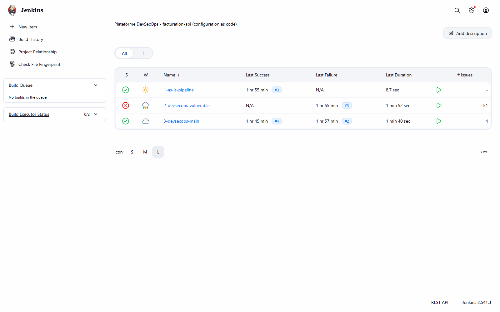

**2. Stage View du job 2** : stages de scan en rouge, production jamais atteinte

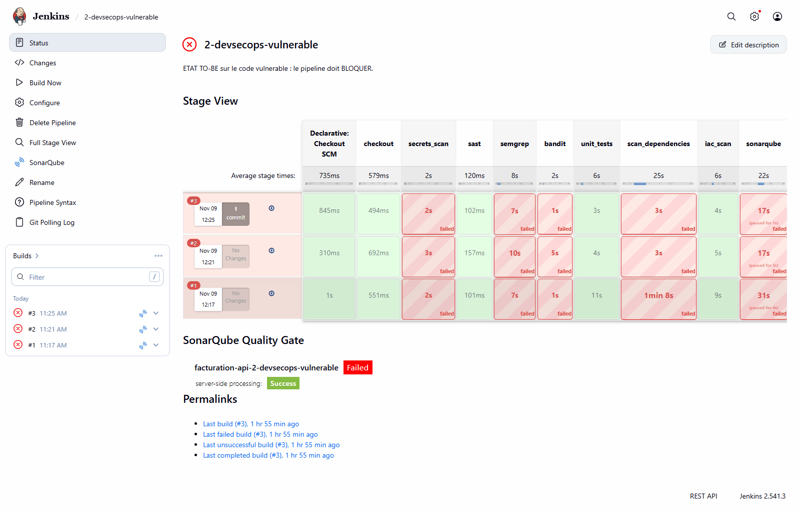

**3. Stage View du job 3** : tout vert jusqu'à `deploy_production`

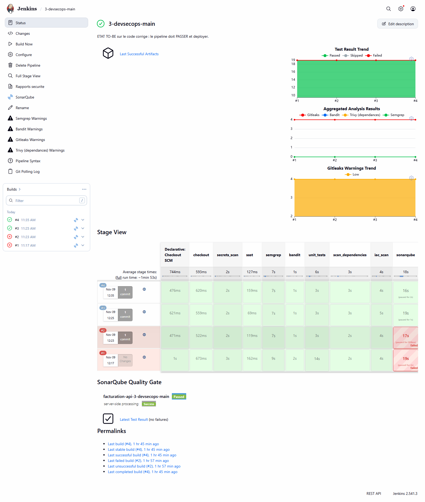

**4. Rapport du quality gate, job 2** : verdict BLOCK, synthèse par outil

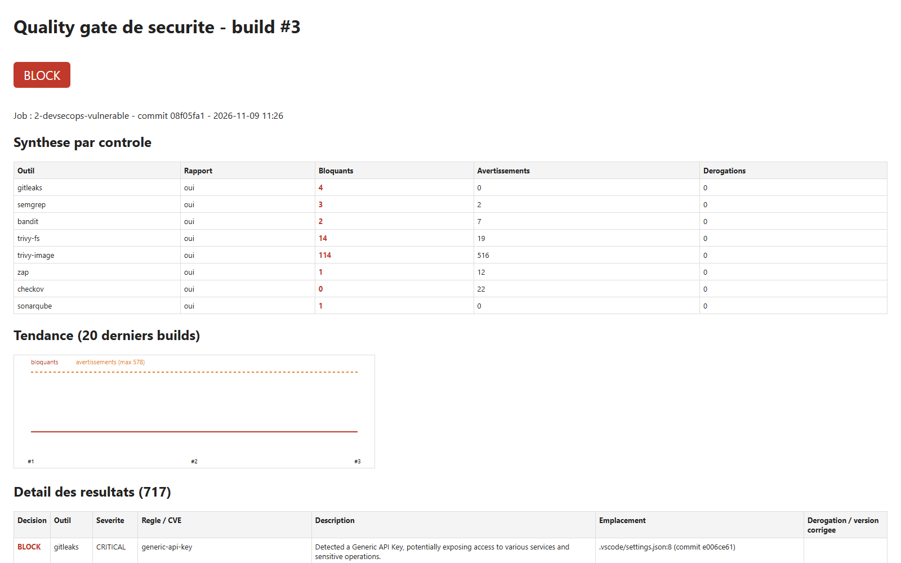

**5. Rapport du quality gate, job 3** : verdict PASS, dérogations et tendance

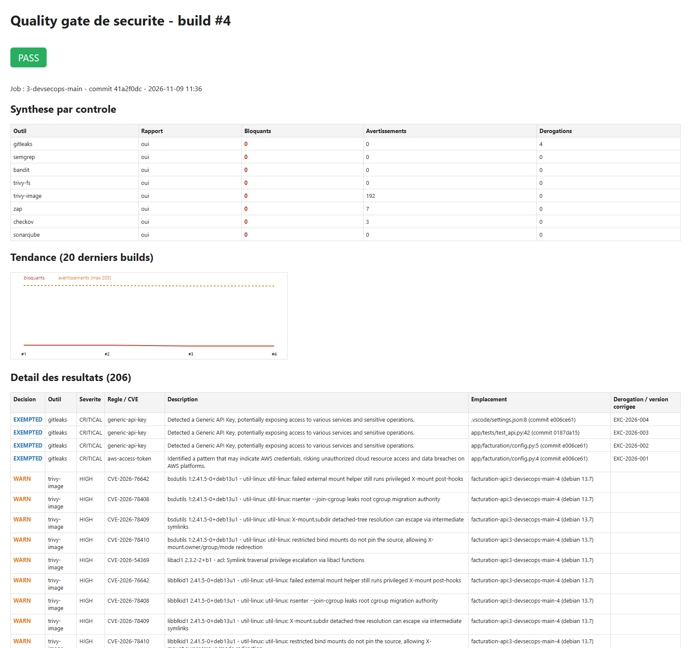

**6. Rapport ZAP, job 2** : *Remote OS Command Injection* (High)

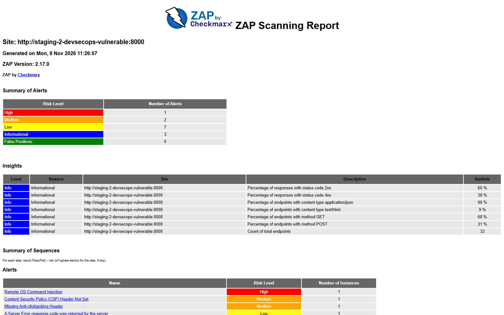

**7. Rapport Trivy image, job 2**

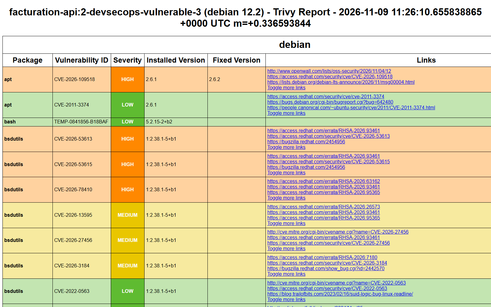

**8. SonarQube** : les deux projets (note E / note A), puis le détail de chacun

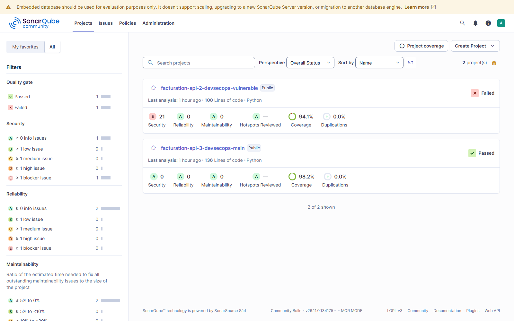
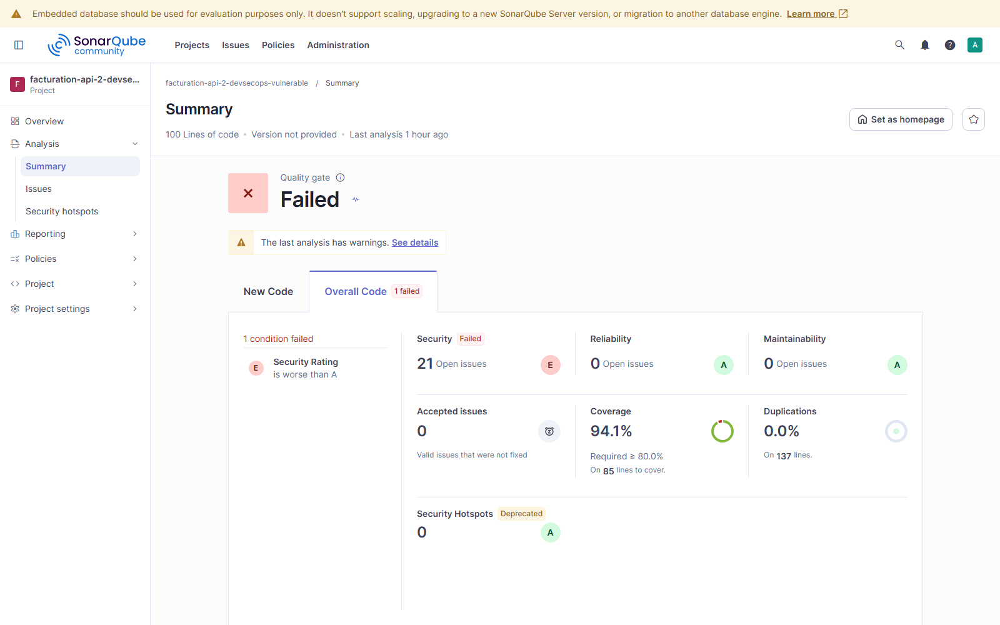
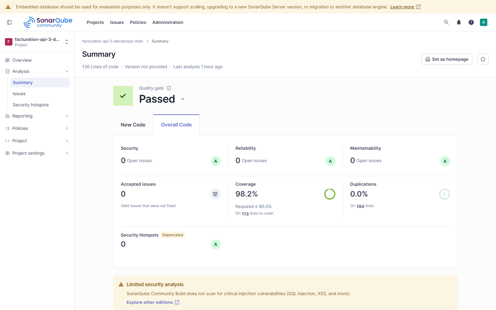

**9. Mailpit** : e-mails `[BLOQUE]` et `[OK]`

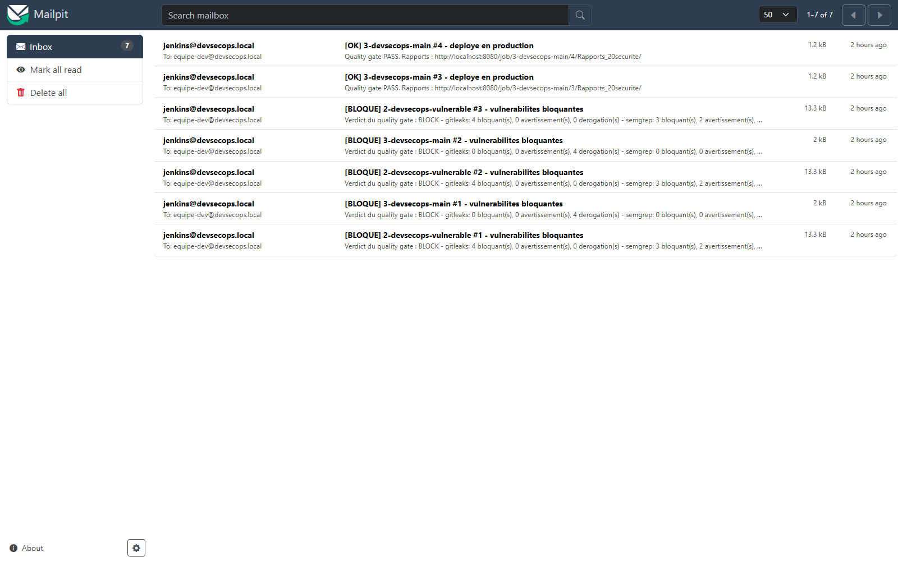

**10. Poste développeur** : commit refusé par le hook pre-commit (Gitleaks, 2 secrets)

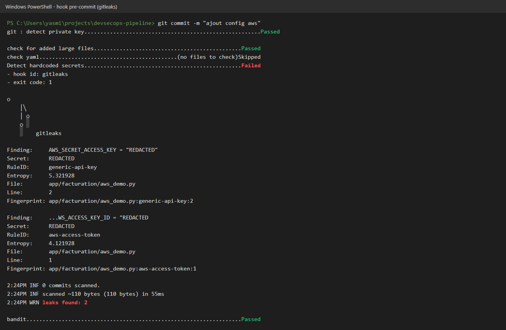

**11. Poste développeur** : Semgrep en local sur la branche `vulnerable` (injection SQL trouvée par la règle personnalisée)

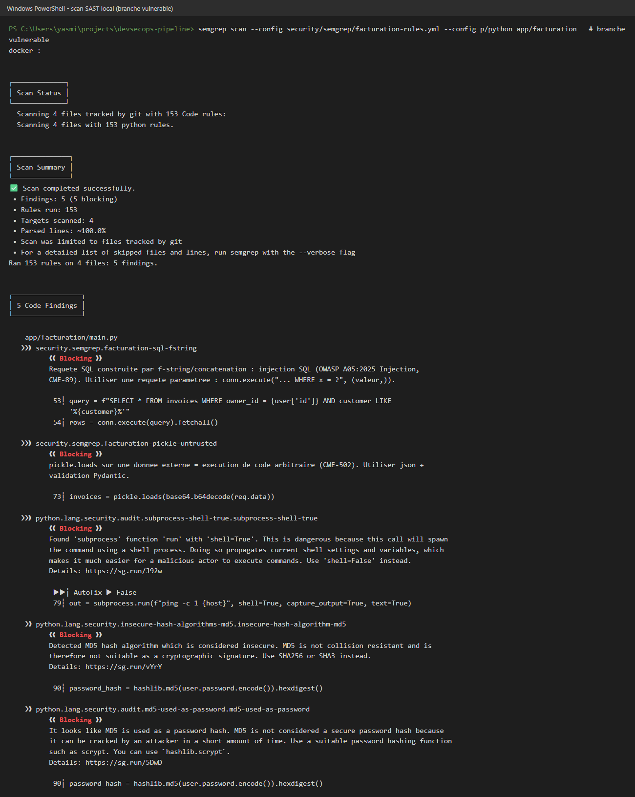

Les captures 10 et 11 sont la sortie réelle des commandes, mise en forme en image.
