# Project report: Securing a CI/CD pipeline (DevSecOps)

**Project:** facturation-api, adding automated security controls from the developer workstation to production
**Date:** 9 November 2026
**Tools:** Jenkins, SonarQube, Gitleaks, Semgrep, Bandit, Trivy, Syft, OWASP ZAP, Checkov, pre-commit, Mailpit

*French version: [RAPPORT.md](RAPPORT.md)*

---

## Contents

1. Context and objectives
2. Methodology
3. Analysis of the existing pipeline (as-is)
4. Developer-side security (shift-left)
5. Automated controls in the pipeline (to-be)
6. Quality gates: blocking thresholds and rationale
7. Pipeline secrets management
8. Reporting, alerting and history
9. Results
10. Exemption process
11. Difficulties encountered
12. Limitations and next steps
13. Appendices (reproducing the project, screenshots)

---

## 1. Context and objectives

`facturation-api` is an invoicing REST API (Python 3.12, FastAPI, SQLite), packaged with Docker.
It was shipped by a classic "DevOps" Jenkins pipeline: tests, build, deploy, with **no security
control at all**.

Objectives:

- add automated controls to the pipeline: **secrets, SAST, SCA, Docker image scan, DAST**, plus
  **IaC** and **SBOM**;
- define **quality gates** that automatically block any critical vulnerability before production;
- equip the **developer workstation** so flaws are caught before the commit (shift-left);
- produce **reports**, **notifications** and a **history** a third-party team can use;
- document a traceable **exemption process**.

## 2. Methodology

1. **Assessment**: map the original pipeline (`Jenkinsfile.asis`) and its weaknesses.
2. **Target design**: choose one tool per category, the stage order and the blocking policy.
3. **Reproducible platform**: Jenkins + SonarQube + Mailpit in Docker, configured **entirely as
   code** (Jenkins Configuration as Code, `infra/bootstrap.ps1`).
4. **Proof by comparison**: the same DevSecOps pipeline runs on two branches:
   - `vulnerable`: the original code (as-is), so the pipeline **must block**;
   - `main`: the fixed code, so the pipeline **must pass** and deploy.
5. **Remediation** of each vulnerability, each with a **regression test**.
6. **Measurement**: every number in this report comes from real Jenkins builds (archived reports).

Three Jenkins jobs are created automatically:

| Job | Branch | Jenkinsfile | Purpose |
|-----|--------|-------------|---------|
| `1-as-is-pipeline` | vulnerable | `Jenkinsfile.asis` | baseline: original pipeline |
| `2-devsecops-vulnerable` | vulnerable | `Jenkinsfile` | proves the controls **block** |
| `3-devsecops-main` | main | `Jenkinsfile` | proves the fixed code **passes** |

## 3. Analysis of the existing pipeline (as-is)

### 3.1 Map

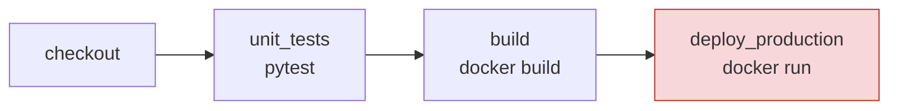

| Step | Tool | Security control |
|------|------|------------------|
| CI/CD | Jenkins (declarative pipeline) | none |
| Dependencies | pip | none (dependencies not checked) |
| Unit tests | pytest | functional tests only |
| Build / packaging | Docker | no image scan |
| Deployment | `docker run` straight to production | no validation, no staging |

### 3.2 Weaknesses found

| # | Weakness | Where | Consequence |
|---|----------|-------|-------------|
| W1 | **Plaintext secrets in code** (AWS key, DB password) | `config.py` | cloud account compromise; the secret stays in Git history |
| W2 | **No code analysis** (SAST) | pipeline | SQL injection, command injection and `pickle` deserialization shipped to production |
| W3 | **Dependencies not checked** (SCA) | `requirements.txt` | PyJWT 2.3.0, urllib3 1.26.4: known CVEs fixed long ago |
| W4 | **Docker image not scanned**, outdated unpinned base (`python:3.12.0-slim`, Debian 12.2) | `Dockerfile` | 114 fixable HIGH/CRITICAL CVEs; container runs as **root** |
| W5 | **Plaintext secret in the pipeline** (`DB_PASSWORD` in the Jenkinsfile) | `Jenkinsfile.asis` | visible to anyone reading the repo or the logs |
| W6 | **Direct deploy to production** with no staging or dynamic testing | pipeline | flaws visible only at runtime go undetected |
| W7 | **No local checks** (IDE, pre-commit) | workstation | flaws are found late, so they cost more |
| W8 | **No security reports, alerts or history** | pipeline | no visibility, no trend tracking |
| W9 | **Infrastructure as code not checked** (`privileged` container, `latest` image) | `k8s/deployment.yaml` | privilege escalation on the cluster |

**Baseline measurement:** the `1-as-is-pipeline` job is **green** and deploys an application with all
these flaws to production. That is exactly the problem to solve.

## 4. Developer-side security (shift-left)

### 4.1 Secured IDE (VS Code)

`.vscode/extensions.json` makes VS Code recommend to every developer:

| Extension | Role |
|-----------|------|
| **SonarLint** (connected mode) | the same rules as the CI SonarQube, shown live in the editor with an explanation |
| **Semgrep** | the same custom rules as the CI (`security/semgrep/`) |
| Python, Docker, YAML | language, Dockerfile and manifest support |

SonarLint connected mode (`.vscode/settings.json`) means the developer sees in the IDE **exactly**
what the CI will flag, with the explanation and the suggested fix.

### 4.2 Pre-commit hooks

`.pre-commit-config.yaml` blocks the commit **on the workstation**, before code leaves the machine:

| Hook | Detects |
|------|---------|
| `gitleaks` | secrets in staged files |
| `bandit` (`-ll`) | Python flaws of severity ≥ MEDIUM |
| `detect-private-key` | PEM/SSH private keys |
| `check-added-large-files`, `check-yaml` | dumps, binaries, invalid YAML |

Design choices:
- each hook repository is **pinned by commit SHA** (a Git tag can be moved);
- only **fast** checks run locally (target under 10 s); heavy scans (Trivy, ZAP, SonarQube) stay in CI;
- hooks can be bypassed (`--no-verify`), which is why **the CI re-runs every check**. The
  workstation speeds up detection; the CI guarantees it.

### 4.3 Targeted local run before push

`scripts/scan-local.ps1` runs the same scanners, **in the same versions** (the Jenkins image) and
with the **same policy** as the CI:

```powershell
powershell -File scripts\scan-local.ps1                  # gitleaks + semgrep + bandit + trivy
powershell -File scripts\scan-local.ps1 -Only semgrep    # a single check
```

### 4.4 Awareness

Every blocking finding links to an explanation: the custom Semgrep rules cite the CWE, the OWASP Top
10 2025 category and the expected fix; the fixed code carries a comment naming the flaw it fixes
(`CORRECTIF (CWE-89) : requête paramétrée…`); `tests/test_security.py` documents each attack as
an executable test.

## 5. Automated controls in the pipeline (to-be)

### 5.1 Final pipeline

```mermaid
flowchart LR
    subgraph Developer workstation
      IDE[IDE<br/>SonarLint + Semgrep] --> PC[pre-commit<br/>Gitleaks, Bandit]
    end
    PC -- push --> CO[checkout]
    CO --> S1[secrets_scan<br/>Gitleaks]
    S1 --> S2[sast<br/>Semgrep ∥ Bandit]
    S2 --> T[unit_tests<br/>pytest ≥80 %]
    T --> S3[scan_dependencies<br/>Trivy fs + Syft SBOM]
    S3 --> S4[iac_scan<br/>Checkov]
    S4 --> SQ[sonarqube<br/>Quality Gate]
    SQ --> B[build<br/>image + SBOM]
    B --> S5[docker_scan<br/>Trivy image]
    S5 --> ST[deploy_staging<br/>isolated container]
    ST --> S6[dast<br/>OWASP ZAP]
    S6 --> G{security_gate}
    G -- PASS --> P[deploy_production]
    G -- BLOCK --> X[build fails<br/>+ email]
    style G fill:#fff3cd,stroke:#e67e22
    style P fill:#d4edda,stroke:#27ae60
    style X fill:#f8d7da,stroke:#c0392b
```

### 5.2 Tools chosen

| Control | Tool | Version | Why |
|---------|------|---------|-----|
| Secrets | **Gitleaks** | 8.30.1 | scans **the whole Git history**, fast, SARIF output; also runs as a pre-commit hook |
| SAST | **Semgrep** | 1.184.0 | ready-made OWASP rules plus **custom rules** that are easy to write |
| SAST | **Bandit** | 1.9.4 | Python specialist (MD5, `shell=True`, `pickle`) |
| SAST + central dashboard | **SonarQube** Community Build | 26.11 | one dashboard, quality gate, history; imports the other reports |
| SCA | **Trivy** (fs) | 0.75.0 | up-to-date vulnerability DB, reports the **fixed version** |
| Image scan | **Trivy** (image) | 0.75.0 | same tool: OS **and** application packages in the image |
| DAST | **OWASP ZAP** (API scan) | stable | **active** scan driven by the API's OpenAPI definition |
| IaC | **Checkov** | 3.4.3 | Dockerfile + Kubernetes, over 1,000 rules |
| SBOM | **Syft** | 1.55.0 | CycloneDX (the format expected by the Cyber Resilience Act) |

All tools are installed in the Jenkins image **at pinned versions**; the Trivy archive is also
**checksum-verified**. Security tools are themselves targets (the Trivy GitHub Action tags were
compromised in March 2026).

### 5.3 Jenkinsfile stages

| Stage | Main command | Reports produced |
|-------|--------------|------------------|
| `secrets_scan` | `gitleaks git` (full history) | `gitleaks.json`, `.sarif` |
| `sast` | `semgrep` ∥ `bandit` (in parallel) | `semgrep.json/.sarif`, `bandit.json/.sarif/.html` |
| `unit_tests` | `pytest --cov-fail-under=80` | `junit.xml`, `coverage.xml` |
| `scan_dependencies` | `trivy fs` + `syft` | `trivy-fs.json/.sarif`, `sbom-source.cdx.json` |
| `iac_scan` | `checkov` | `results_json.json` |
| `sonarqube` | `sonar-scanner` + `waitForQualityGate` | SonarQube dashboard |
| `build` | `docker build` + `syft` | `sbom-image.cdx.json` |
| `docker_scan` | `trivy image` | `trivy-image.json/.html` |
| `deploy_staging` | isolated container on an internal network | none |
| `dast` | `zap-api-scan.py` (OpenAPI) | `zap.json/.html` |
| `security_gate` | `security/gate.py evaluate` | `security-gate.html/.json`, history |
| `deploy_production` | only if everything passes | none |

**On failure.** Each scan stage calls `gate.py check --tool <tool>`: if it finds a blocking
result, the stage turns **red** but the following scans still run (`catchError`). The developer
gets **the full list** of problems in a single run. The `security_gate` stage then makes the overall
decision and **prevents the production deploy**.

**Trigger.** Automatic on **every commit** (Jenkins polls the repository every minute), with no
manual step. The builds in this report show the cause *"Started by an SCM change"*.

## 6. Quality gates: blocking thresholds and rationale

The policy is a versioned, reviewed file (`security/policy.yml`), applied by a single script
(`security/gate.py`) that normalises the results of every tool.

| Control | Blocking | Non-blocking (warning) | Rationale |
|---------|----------|------------------------|-----------|
| Secrets | **every finding** | none | a committed secret must be treated as compromised, whatever its "severity" |
| SAST Semgrep | HIGH, CRITICAL | MEDIUM, LOW | ERROR-level rules match exploitable flaws (injection, RCE) |
| SAST Bandit | HIGH **with confidence ≥ MEDIUM** | the rest | Bandit produces low-confidence false positives; this avoids alert fatigue |
| SCA (Trivy fs) | CRITICAL, HIGH (CVSS ≥ 7.0) **if a fix exists** | MEDIUM, LOW, and HIGH with no fix | blocking on a CVE with no fix allows no action and stalls the team |
| Docker image | same as SCA | same | same logic for the base OS packages |
| DAST ZAP | **High** risk | Medium, Low, Info | a High alert in staging is an exploitable flaw confirmed at runtime |
| IaC Checkov | none (observation mode) | everything | 2–4 week observation period to measure noise before blocking |
| SonarQube | Quality Gate `ERROR` | none | "DevSecOps" gate: security rating **A**, reliability ≥ C, coverage ≥ 80 % |
| Process | **missing or unreadable report** | none | "missing = failed": a broken scanner must not let a build through |

**CVSS v3 mapping:** CRITICAL ≥ 9.0; HIGH 7.0–8.9; MEDIUM 4.0–6.9; LOW < 4.0.
The threshold is therefore: **block from CVSS 7.0 when a fix is available**.

**Blocking vs non-blocking.** Warnings are not ignored: they appear in the HTML report, in
SonarQube and in the history. They prepare progressive hardening (for example, making Checkov
blocking once its noise is measured).

## 7. Pipeline secrets management

The pipeline must not reproduce the flaws it is meant to catch:

| Before (as-is) | After (to-be) |
|----------------|---------------|
| `DB_PASSWORD = 'Sup3rS3cret!2026'` in plaintext in the Jenkinsfile | no secret in the Jenkinsfile |
| none | SonarQube token stored as a **Jenkins credential** (secret text), injected by `withSonarQubeEnv`, **masked** in logs |
| default admin password | passwords **randomly generated** by `bootstrap.ps1`; SonarQube's `admin/admin` changed automatically |
| none | `infra/.env` file **excluded from Git** (`.gitignore`); Jenkins reads it through JCasC (`${SONAR_TOKEN}`) |
| none | production container: no secret in the image, user 10001, read-only filesystem |

**Planned evolution:** HashiCorp Vault (Jenkins Vault plugin) for short-lived secrets, and OIDC
federation to remove static secrets.

## 8. Reporting, alerting and history

| Need | Implementation |
|------|----------------|
| **JSON** report per scan | `reports/*.json` archived on every build (Jenkins artifacts) |
| Readable **HTML** reports | "Rapports securite" tab on each build: consolidated quality gate, ZAP, Trivy image, Bandit |
| **Centralisation** | **SonarQube**: native analysis + import of Bandit (JSON) and Semgrep/Gitleaks (SARIF) results; *Warnings NG* plugin in Jenkins |
| **Notification** | automatic email on every build: `[BLOQUE] …` listing the blocking findings, or `[OK] … deployed to production` (Mailpit SMTP server, viewable at http://localhost:8025) |
| **History / trend** | (1) `security-history/<job>.jsonl`: one line per build, chart of the last 20 builds in the HTML report; (2) *Warnings NG* trend charts; (3) SonarQube *Activity* tab; (4) 30 builds kept in Jenkins |

The consolidated `security-gate.html` report shows the verdict, a per-tool summary (blocking /
warnings / exemptions), the trend chart and the detail of every finding (rule or CVE, location,
fixed version or applied exemption).

## 9. Results

### 9.1 The three pipelines compared (builds triggered automatically by commit)

| Job | Result | Duration |
|-----|--------|----------|
| `1-as-is-pipeline` | ✅ SUCCESS, **deploys the vulnerable application** | 9 s (warm cache) |
| `2-devsecops-vulnerable` | ❌ **FAILURE, production blocked** | 113 s |
| `3-devsecops-main` | ✅ SUCCESS, deployed to production | about 2 min |

Cost of security: about **2 minutes** per build, of which 37–45 s is DAST. That is well under the
8-minute target for a merge-request pipeline.

### 9.2 Quality gate results

| Control | Vulnerable code | Fixed code |
|---------|-----------------|------------|
| Secrets (Gitleaks) | **4 blocking** | 0 (4 tracked exemptions) |
| SAST Semgrep | **3 blocking**, 2 warnings | 0 |
| SAST Bandit | **2 blocking**, 7 warnings | 0 |
| SCA Trivy | **14 blocking** (33 CVEs in total) | 0 |
| Docker image Trivy | **114 blocking** (630 CVEs in total) | 0 blocking, 192 warnings (no fix available) |
| DAST ZAP | **1 blocking** (*Remote OS Command Injection*), 12 warnings | 0, 7 warnings |
| IaC Checkov | 22 warnings | 3 warnings |
| SonarQube | Quality Gate **ERROR**, security rating **E**, 21 vulnerabilities | Quality Gate **OK**, rating **A**, 0 vulnerabilities, 98.2 % coverage |
| **Verdict** | **BLOCK, 139 blocking findings** | **PASS** |

### 9.3 Vulnerabilities found and fixed

| Flaw | CWE / OWASP | Found by | Fix | Regression test |
|------|-------------|----------|-----|-----------------|
| Plaintext AWS key and password | CWE-798 | Gitleaks, Bandit (B105) | environment variables; **keys revoked** | secrets gate |
| SQL injection (f-string) | CWE-89 / A05 Injection | **Semgrep** (custom rule), Bandit B608 | parameterised query | `test_sql_injection_…` |
| `pickle` deserialization | CWE-502 / A08 | **Semgrep** (custom rule), Bandit B301 | JSON + Pydantic schema | `test_import_rejects_…` |
| Command injection `shell=True` | CWE-78 / A05 | **Semgrep, Bandit B602, ZAP (High, at runtime)** | no shell, input validation, authentication | `test_command_injection_…` |
| MD5 password hashing | CWE-327 / A04 | Bandit B324, Semgrep | salted `scrypt` | `test_password_is_not_md5` |
| Reflected XSS | CWE-79 / A05 | code review | `html.escape` | `test_xss_is_escaped` |
| BOLA (reading another user's invoice) | OWASP API1 | **no tool**, code review | `owner_id` filter | `test_bola_…` |
| Missing security headers | A02 | ZAP | headers middleware | `test_security_headers_present` |
| PyJWT 2.3.0, urllib3 1.26.4, jinja2, requests | CVE-2022-29217, CVE-2021-33503… | Trivy fs | removed unused dependencies, upgrades, exact versions | SCA gate |
| Outdated base image, root container | none | Trivy image, Checkov | recent image **pinned by digest**, multi-stage, user 10001, `apt-get upgrade` | image gate |
| `privileged` K8s container, `latest` tag | none | Checkov | hardened `securityContext`, image by digest, resource limits | none |

**Key lesson:** **BOLA** and **XSS** were flagged by no scanner. Automated tools do not understand
business logic ("does this invoice belong to this user?"). The pipeline complements code review and
penetration testing; it does not replace them.

## 10. Exemption process

Full detail: `docs/PROCEDURE_DEROGATION.md`. In short, a blocking finding can only be lifted by
an entry in `security/exemptions.yml` that states **the tool, the rule, the exact location, the
justification, the approver, the ticket and an expiry date**. The gate **rejects** an incomplete
entry, and an **expired exemption blocks again**. The same register filters the results imported
into SonarQube (`gate.py filter-sarif`), so it is the **single source of truth**.

Real case from this project: after the code was fixed, Gitleaks still blocked `main`, because the
AWS keys remain in the **Git history** of the first commit. Handling: revoke the keys, exemptions
EXC-2026-001/002 expiring in 6 months, and a planned history rewrite. Two other findings were genuine
false positives (EXC-2026-003/004).

## 11. Difficulties encountered

| Difficulty | Solution |
|------------|----------|
| SonarQube (Elasticsearch) needs a high `vm.max_map_count`, unavailable on Docker Desktop/WSL2 | `-Dnode.store.allow_mmap=false` option |
| Jenkins could not access the Docker socket (owned by `root:root`) | `group_add: ["0"]` in docker-compose (accepted limitation, see §12) |
| The deleted secret was still detected in Git history | tracked exemption after revocation: a committed secret cannot be "made to disappear" |
| SonarQube also imported Gitleaks findings covered by an exemption | SARIF filtering by the gate before import |
| Even **today's** Python image had 2 zlib CVEs fixed in Debian but not yet in the official image | `apt-get upgrade` when building the image |
| Parameter named `branch` clashed with the Job DSL `branch()` method | renamed |
| HTML reports showed without styling (Jenkins CSP) | CSP relaxed for the lab (not for production: serve reports elsewhere) |

## 12. Limitations and next steps

**Accepted lab limitations:**
- Jenkins can access the host's Docker socket, which is equivalent to root on the machine. In
  production: ephemeral build agents, rootless Docker, Kaniko or BuildKit.
- SonarQube Community does not do data-flow (taint) analysis for Python. Semgrep's custom rules
  fill that gap.
- 192 CVEs in the final image have no fix yet and stay as warnings: they must be tracked.
- The Git repository is local (polled every minute). On GitLab or GitHub, a webhook would trigger
  the build instantly.

**Roadmap:**
1. **Image signing** (cosign) and **admission-time verification** in Kubernetes (Kyverno).
2. **Vault** for secrets, **OIDC** to remove static credentials.
3. **Dependency-Track**: continuous SBOM monitoring (new CVE → automatic ticket with an SLA).
4. Make Checkov **blocking** after the observation period; **distroless** or Chainguard base image.
5. **Slack/Teams** notifications; Grafana dashboard over the history.
6. Authorization tests generated from OpenAPI (Schemathesis) to catch BOLA automatically.

## 13. Appendices

### 13.1 Reproducing the project

```powershell
git clone <repo> ; cd devsecops-pipeline
powershell -ExecutionPolicy Bypass -File infra\bootstrap.ps1   # about 5 min the first time
# Jenkins http://localhost:8080 - SonarQube http://localhost:9000 - Mailpit http://localhost:8025
# (credentials printed by the script, stored in infra\.env)
```

### 13.2 Layout

```
Jenkinsfile                 DevSecOps pipeline (to-be), commented
Jenkinsfile.asis            original pipeline (as-is)
app/                        facturation-api (code, tests, Dockerfile)
k8s/deployment.yaml         Kubernetes manifest (scanned by Checkov)
security/policy.yml         quality gate policy
security/exemptions.yml     exemption register
security/gate.py            quality gate engine (normalisation, decision, reports, history)
security/semgrep/           custom Semgrep rules
.pre-commit-config.yaml     local hooks
.vscode/                    extensions and SonarLint/Semgrep settings
infra/                      docker-compose, Jenkins image, JCasC, bootstrap
scripts/scan-local.ps1      targeted local run before push
docs/                       reports (FR/EN), exemption process, oral preparation, screenshots
```

### 13.3 Screenshots

Taken on the running platform (folder `docs/captures/`).

**1. Jenkins: the 3 jobs** (green / red / green)

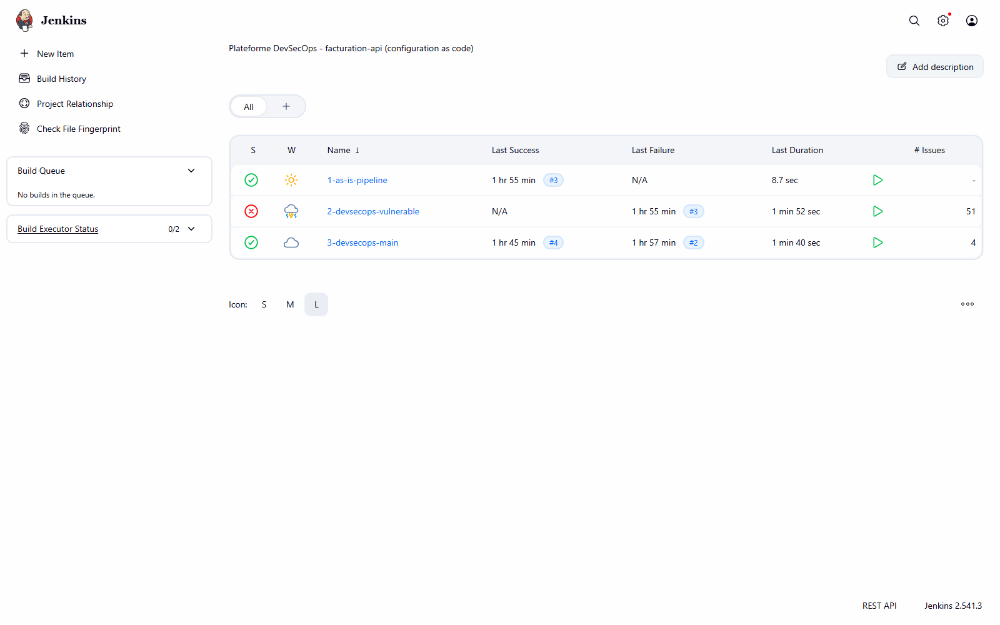

**2. Job 2 Stage View**: scan stages in red, production never reached

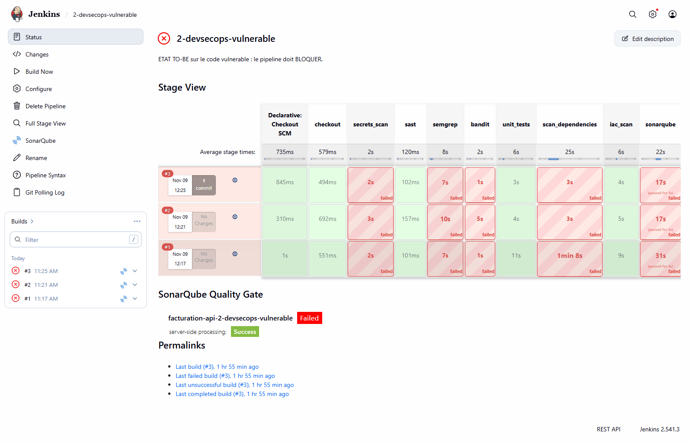

**3. Job 3 Stage View**: green all the way to `deploy_production`

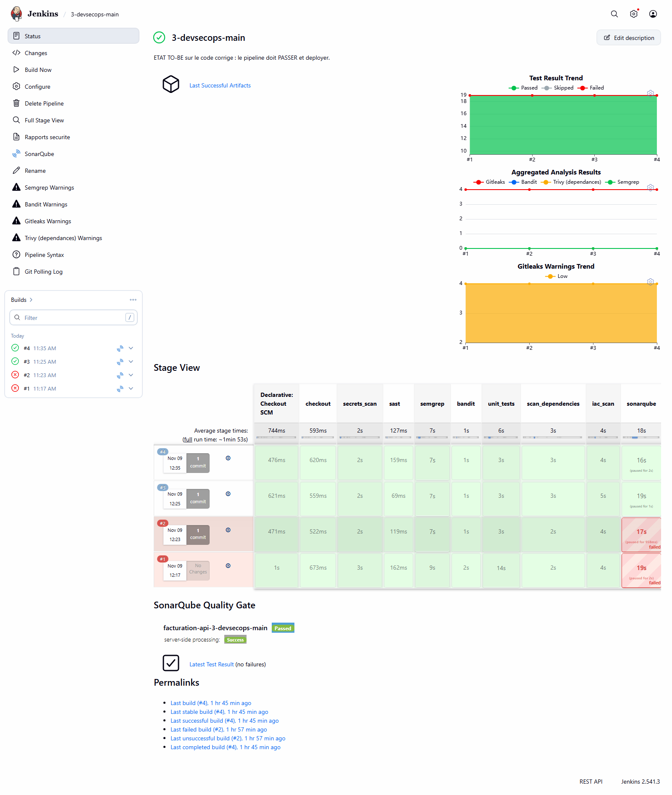

**4. Quality gate report, job 2**: BLOCK verdict, per-tool summary

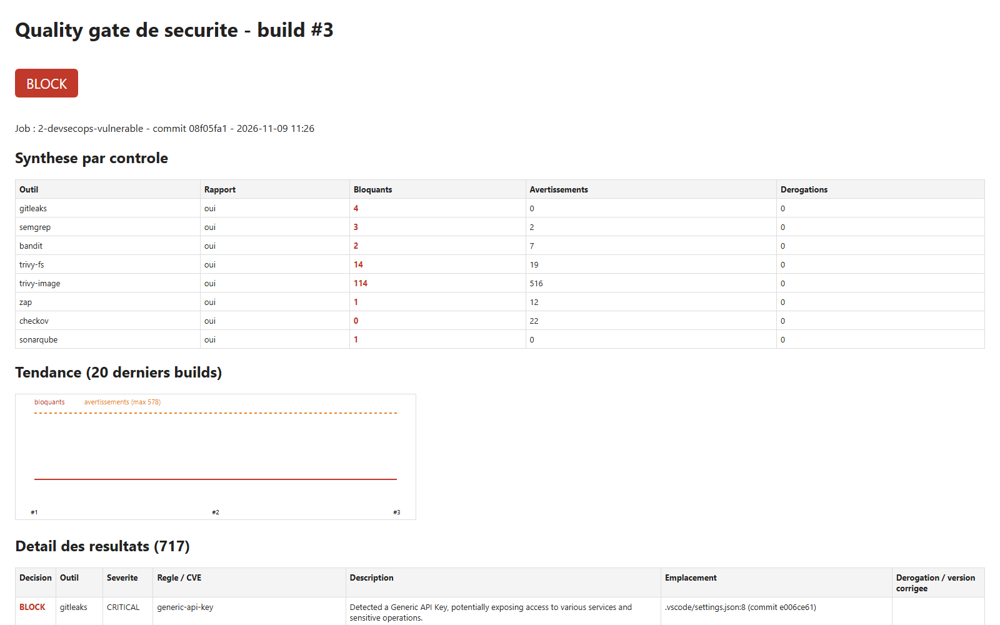

**5. Quality gate report, job 3**: PASS verdict, exemptions and trend

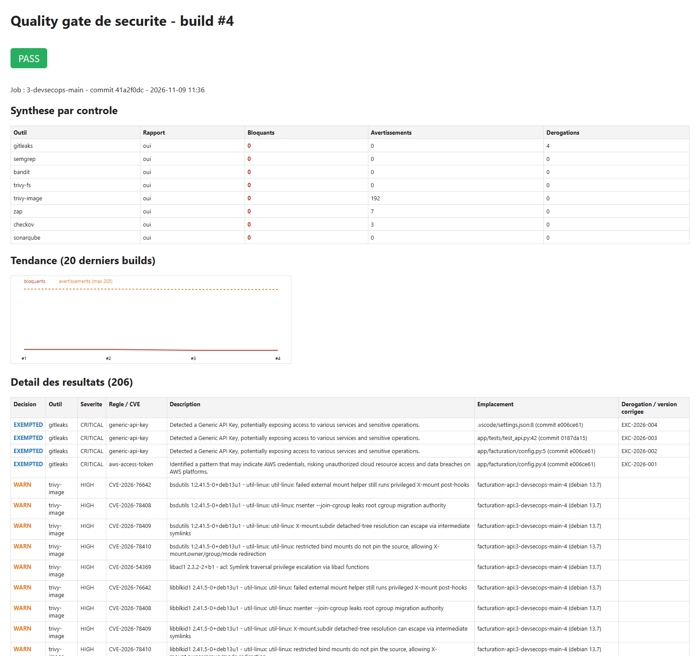

**6. ZAP report, job 2**: *Remote OS Command Injection* (High)

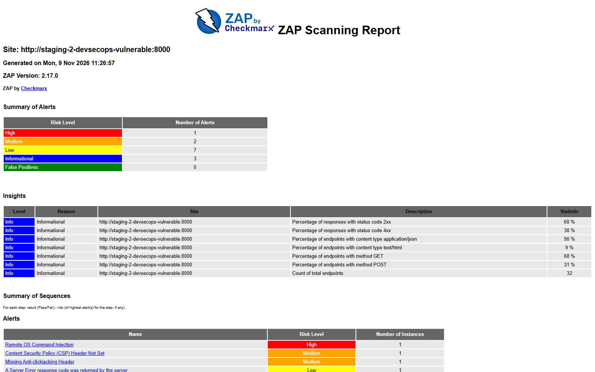

**7. Trivy image report, job 2**

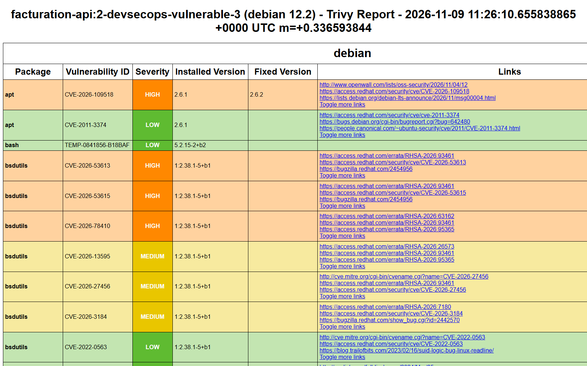

**8. SonarQube**: both projects (rating E / rating A), then each in detail

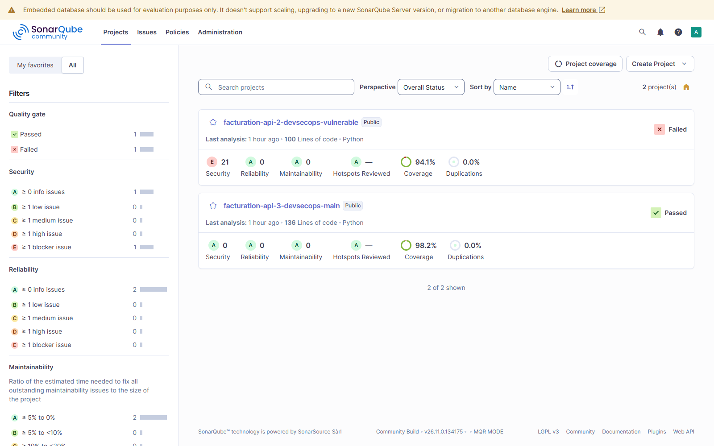
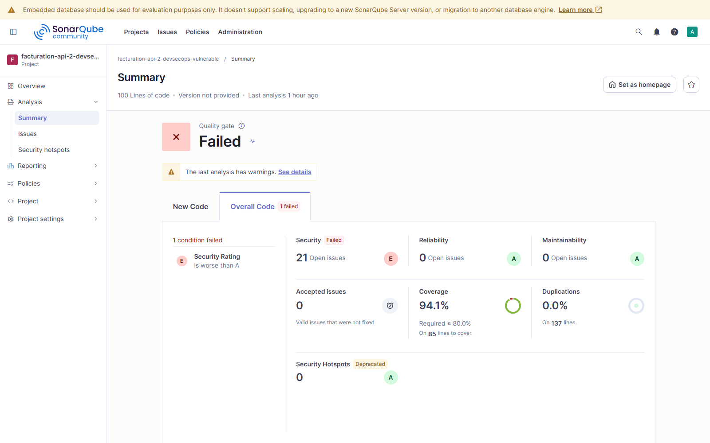
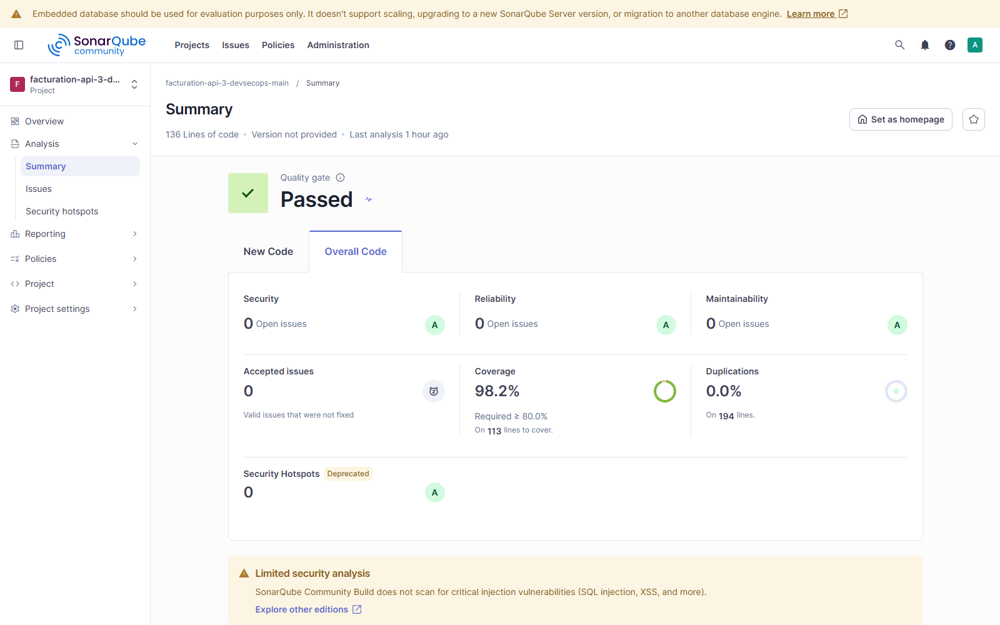

**9. Mailpit**: `[BLOQUE]` and `[OK]` emails

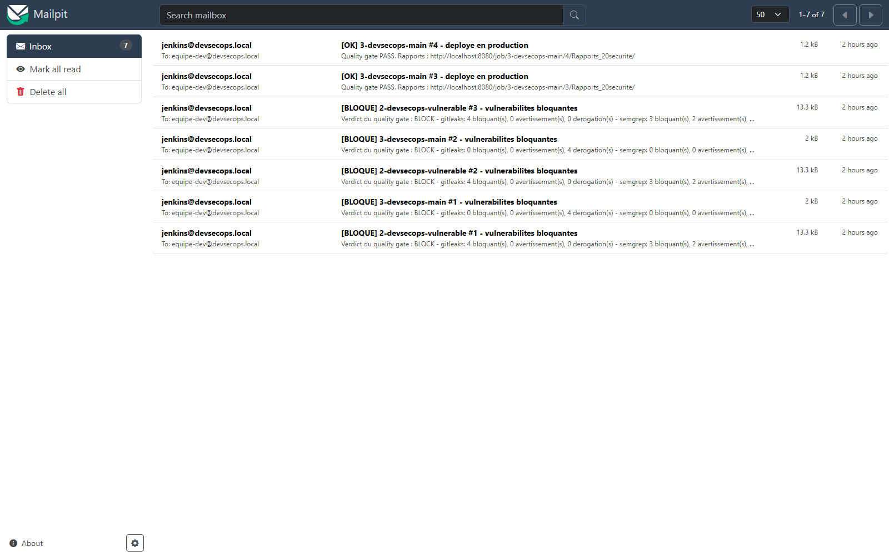

**10. Developer workstation**: commit refused by the pre-commit hook (Gitleaks, 2 secrets)

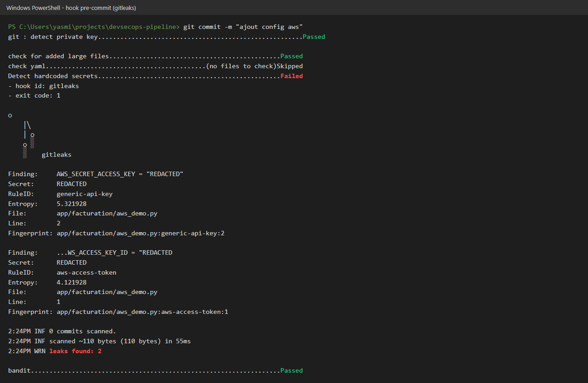

**11. Developer workstation**: local Semgrep run on the `vulnerable` branch (SQL injection found by the custom rule)

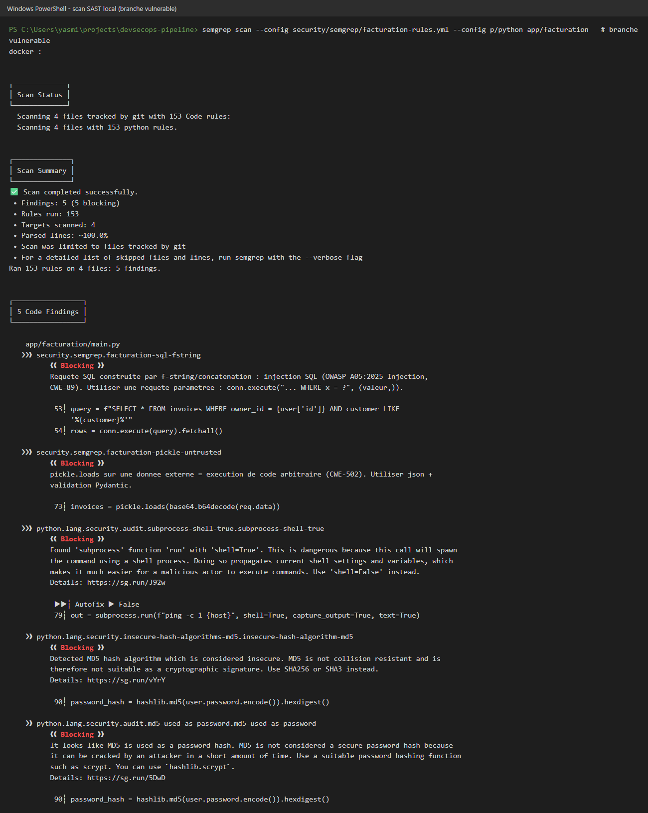

Screenshots 10 and 11 are the real command output, rendered as an image.
